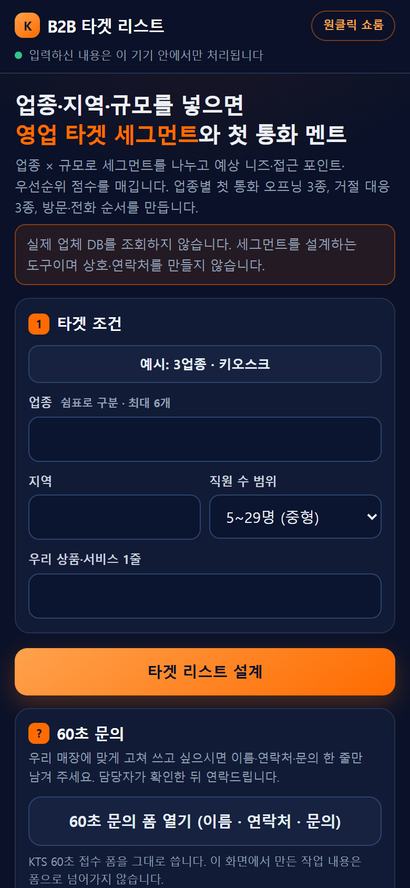
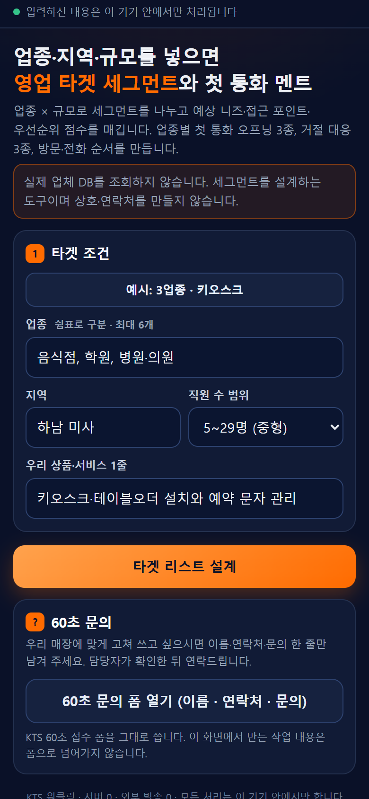
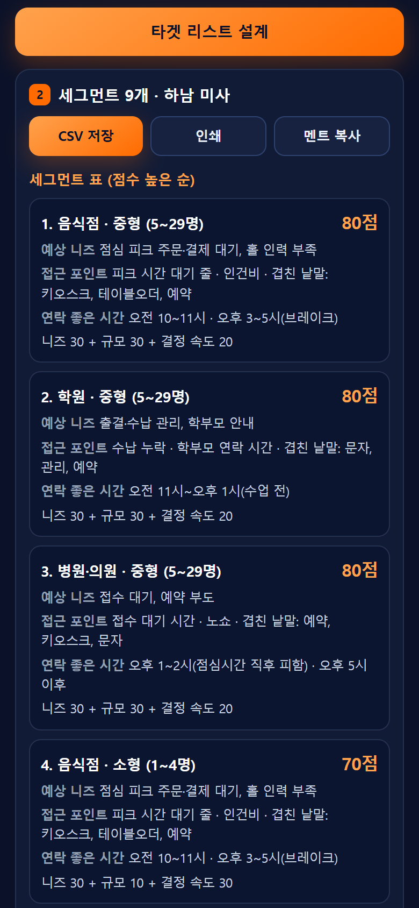

# B2B 영업 타겟 업종별 리스트업 정리기 사용설명서

- 앱: `oneclick/b2blist.html` (단일 HTML · 설치 없음 · 서버 0)
- 업종·지역·직원 수·우리 상품 1줄을 넣으면 업종 × 규모 세그먼트 표(예상 니즈·접근 포인트·우선순위 점수), 업종별 첫 통화 오프닝 3종, 거절 대응 3종, 방문·전화 순서를 만듭니다. 실제 업체 DB를 조회하지 않습니다.
- 입력하신 내용은 이 기기 안에서만 처리됩니다.

## ① 누르는 곳

[예시: 3업종 · 키오스크]를 누르거나 업종을 쉼표로 적으세요.

## ② 입력

지역·직원 수·우리 상품 1줄을 확인하고 [타겟 리스트 설계]를 누릅니다.

## ③ 결과

점수 높은 순 세그먼트와 멘트가 나옵니다. [멘트 복사] · [CSV 저장] · [인쇄]. 실제 업체 목록은 직접 모은 자료로 채우세요.

## 60초 문의
화면 맨 아래 **[60초 문의 폼 열기]** 를 누르면 KTS 60초 접수 폼(`misa-1116/form.html`)이 열립니다. 이름·연락처·문의만 남기면 됩니다.

> 390px 실물 캡처: `390_b2blist.png` · 실제로 누른 자리 기록: `shots/b2blist/marks.json` · 검증 로그: `shots/b2blist/run_log.txt`