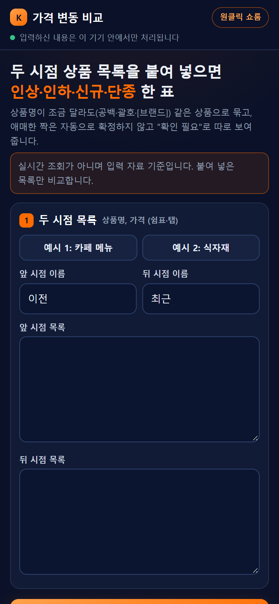
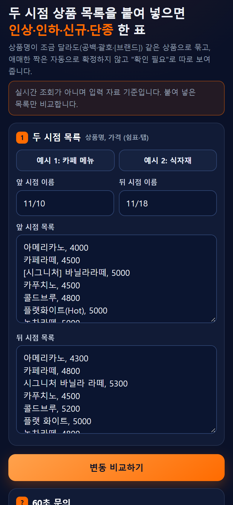
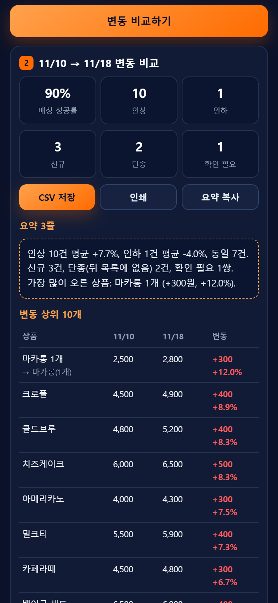

# 경쟁사 가격·상품 변동 비교 정리기 사용설명서

- 앱: `oneclick/compwatch.html` (단일 HTML · 설치 없음 · 서버 0)
- 두 시점 상품 목록(상품명, 가격)을 붙여 넣으면 같은 상품을 묶어 인상·인하·신규·단종과 변동액·변동률, 상위 10개, 요약 3줄을 냅니다. 애매한 짝은 "확인 필요"로 따로 둡니다.
- 입력하신 내용은 이 기기 안에서만 처리됩니다.

## ① 누르는 곳

[예시 1: 카페 메뉴]를 누르거나 두 시점 목록을 붙여 넣으세요.

## ② 입력

시점 이름(예: 11/10, 11/18)을 확인하고 [변동 비교하기]를 누릅니다.

## ③ 결과

매칭 성공률·변동 표가 나옵니다. 확인 필요 짝은 [같은 상품으로 묶기]로 직접 확정하고, [CSV 저장]으로 엑셀에 옮기세요.

## 60초 문의
화면 맨 아래 **[60초 문의 폼 열기]** 를 누르면 KTS 60초 접수 폼(`misa-1116/form.html`)이 열립니다. 이름·연락처·문의만 남기면 됩니다.

> 390px 실물 캡처: `390_compwatch.png` · 실제로 누른 자리 기록: `shots/compwatch/marks.json` · 검증 로그: `shots/compwatch/run_log.txt`