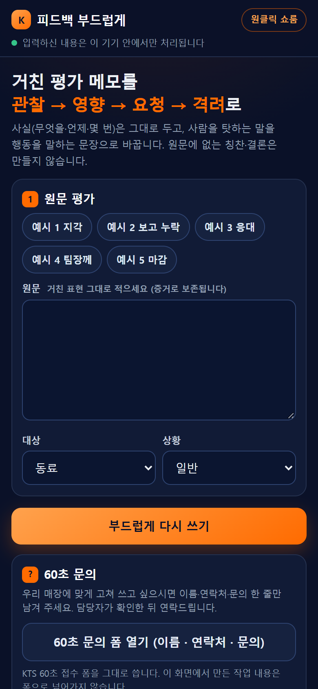
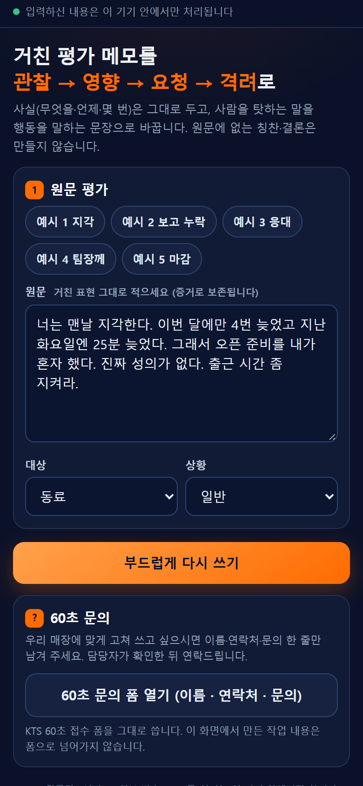
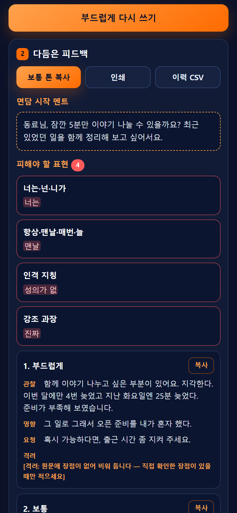

# 동료 평가 → 부드러운 인사고과 피드백 사용설명서

- 앱: `oneclick/feedbacksoft.html` (단일 HTML · 설치 없음 · 서버 0)
- 거친 평가 메모를 관찰 → 영향 → 요청 → 격려 4단 문장으로 바꿉니다. 사실은 그대로, 인격 표현은 행동 표현으로 바꾸고, 원문에 없는 칭찬은 만들지 않습니다.
- 입력하신 내용은 이 기기 안에서만 처리됩니다.

## ① 누르는 곳

[예시 1 지각]을 누르거나, 원문 평가를 거친 표현 그대로 적으세요.

## ② 입력

대상(동료·후배·팀장)과 상황을 고르고 [부드럽게 다시 쓰기]를 누릅니다.

## ③ 결과

면담 시작 멘트·피해야 할 표현·3단 톤 문장이 나옵니다. 원하는 톤의 [복사]를 누르세요. 이력 20건이 이 기기에 저장됩니다.

## 60초 문의
화면 맨 아래 **[60초 문의 폼 열기]** 를 누르면 KTS 60초 접수 폼(`misa-1116/form.html`)이 열립니다. 이름·연락처·문의만 남기면 됩니다.

> 390px 실물 캡처: `390_feedbacksoft.png` · 실제로 누른 자리 기록: `shots/feedbacksoft/marks.json` · 검증 로그: `shots/feedbacksoft/run_log.txt`