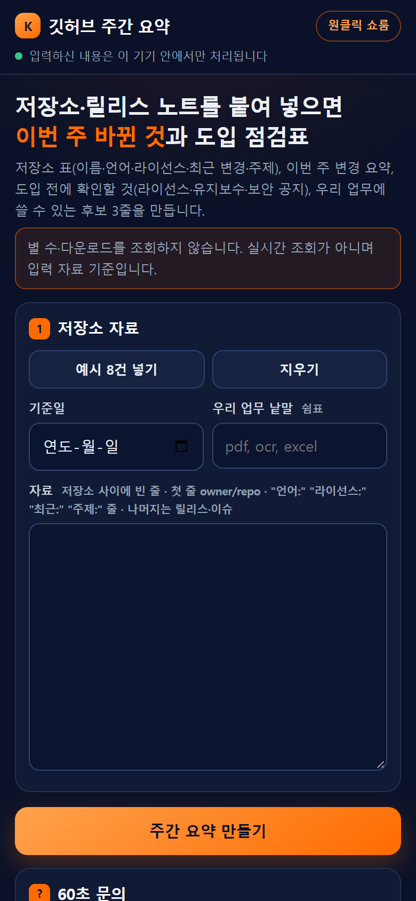
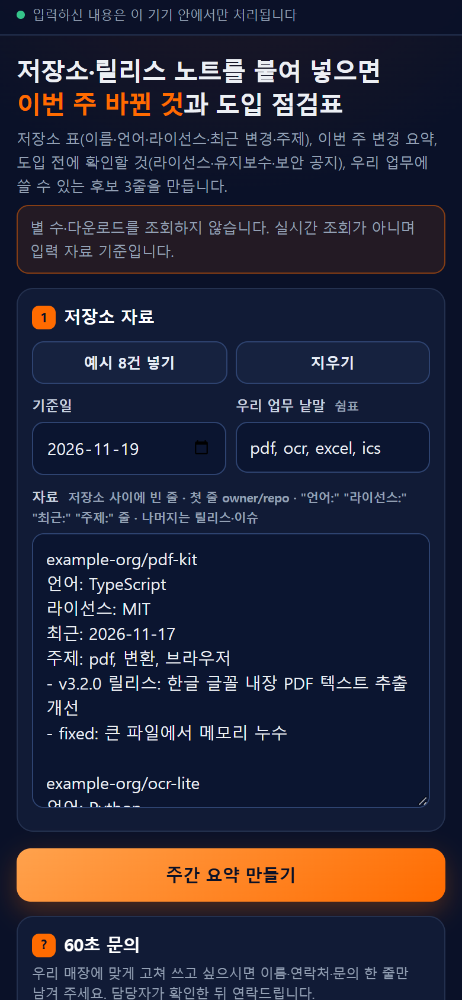
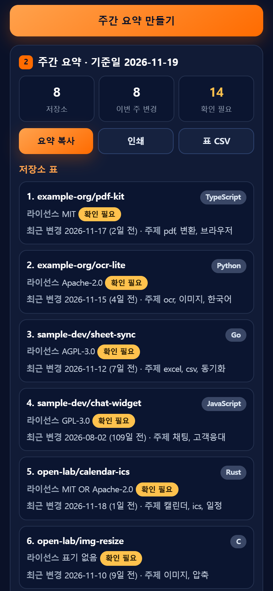

# 오픈소스·GitHub 주간 트렌드 요약기 사용설명서

- 앱: `oneclick/ghtrend.html` (단일 HTML · 설치 없음 · 서버 0)
- 저장소 목록·릴리스 노트·이슈를 붙여 넣으면 저장소 표, 이번 주 바뀐 것, 도입 시 확인할 것(라이선스·유지보수·보안), 우리 업무 후보 3줄을 만듭니다. 라이선스는 단정하지 않고 "확인 필요"로 둡니다.
- 입력하신 내용은 이 기기 안에서만 처리됩니다.

## ① 누르는 곳

[예시 8건 넣기]를 누르거나, 저장소 사이에 빈 줄을 두고 붙여 넣으세요.

## ② 입력

기준일과 우리 업무 낱말(pdf, ocr 등)을 확인하고 [주간 요약 만들기]를 누릅니다.

## ③ 결과

표·변경 요약·확인 목록이 나옵니다. [요약 복사] · [인쇄] · [표 CSV].

## 60초 문의
화면 맨 아래 **[60초 문의 폼 열기]** 를 누르면 KTS 60초 접수 폼(`misa-1116/form.html`)이 열립니다. 이름·연락처·문의만 남기면 됩니다.

> 390px 실물 캡처: `390_ghtrend.png` · 실제로 누른 자리 기록: `shots/ghtrend/marks.json` · 검증 로그: `shots/ghtrend/run_log.txt`