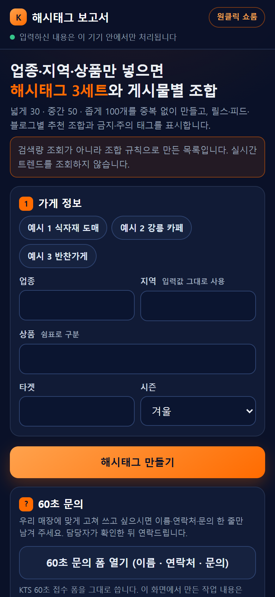
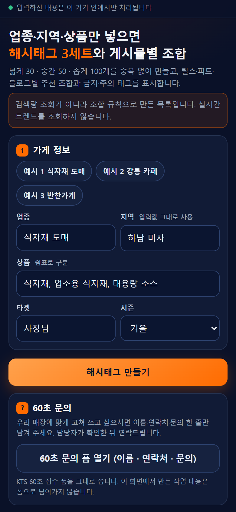
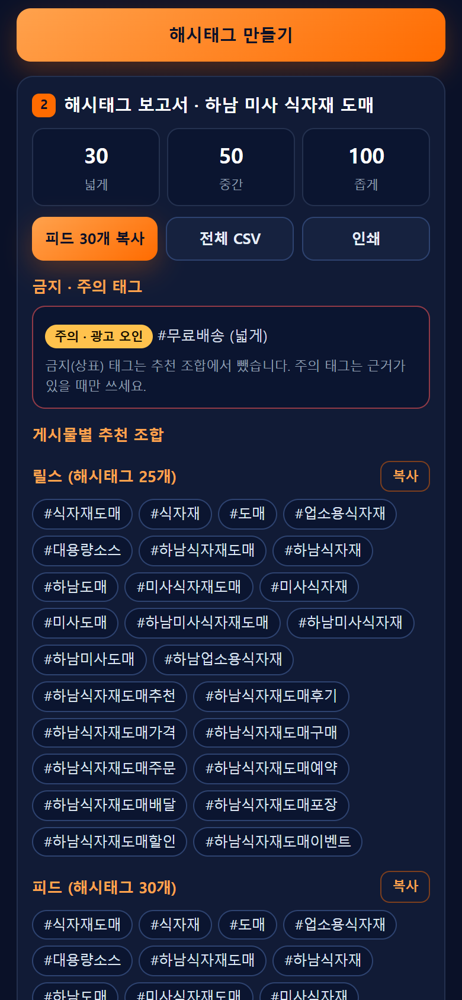

# SNS 해시태그·트렌드 보고서 사용설명서

- 앱: `oneclick/hashtagreport.html` (단일 HTML · 설치 없음 · 서버 0)
- 업종·지역·상품·타겟·시즌을 넣으면 넓게 30 · 중간 50 · 좁게 100개 해시태그(중복 0)와 릴스·피드·블로그별 추천 조합, 금지·주의 태그 표시를 만듭니다. 검색량 조회가 아니라 조합 규칙으로 만든 목록입니다.
- 입력하신 내용은 이 기기 안에서만 처리됩니다.

## ① 누르는 곳

[예시 1 식자재 도매]를 누르거나 업종·지역·상품을 적으세요.

## ② 입력

타겟·시즌을 확인하고 [해시태그 만들기]를 누릅니다.

## ③ 결과

3세트와 게시물별 조합이 나옵니다. 조합마다 [복사], 전체는 [CSV]. 빨간(금지)·노란(주의) 태그는 근거가 있을 때만 쓰세요.

## 60초 문의
화면 맨 아래 **[60초 문의 폼 열기]** 를 누르면 KTS 60초 접수 폼(`misa-1116/form.html`)이 열립니다. 이름·연락처·문의만 남기면 됩니다.

> 390px 실물 캡처: `390_hashtagreport.png` · 실제로 누른 자리 기록: `shots/hashtagreport/marks.json` · 검증 로그: `shots/hashtagreport/run_log.txt`