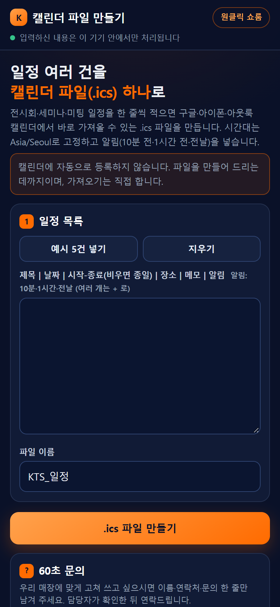
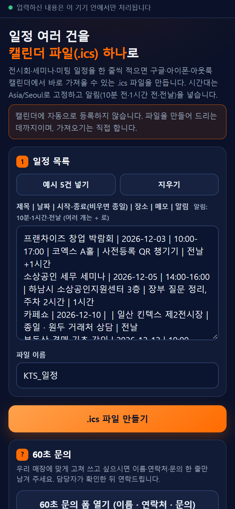
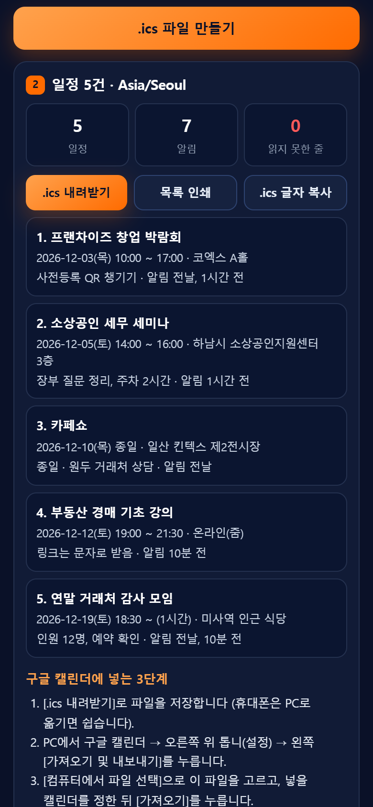

# 전시회·세미나 일정 → 캘린더(.ics) 생성기 사용설명서

- 앱: `oneclick/icsmaker.html` (단일 HTML · 설치 없음 · 서버 0)
- 일정 여러 건(제목 | 날짜 | 시간 | 장소 | 메모 | 알림)을 적으면 RFC 5545 규격 .ics 파일 하나로 만듭니다. 시간대 Asia/Seoul, 종일/시간 지정, 알림 10분·1시간·전날. 캘린더에 자동 등록하지 않습니다.
- 입력하신 내용은 이 기기 안에서만 처리됩니다.

## ① 누르는 곳

[예시 5건 넣기]를 누르거나 한 줄에 일정 하나씩 적으세요.

## ② 입력

파일 이름을 정하고 [.ics 파일 만들기]를 누릅니다.

## ③ 결과

[.ics 내려받기]로 파일을 저장하고, 화면의 구글 캘린더 3단계대로 가져오세요. [목록 인쇄]도 됩니다.

## 60초 문의
화면 맨 아래 **[60초 문의 폼 열기]** 를 누르면 KTS 60초 접수 폼(`misa-1116/form.html`)이 열립니다. 이름·연락처·문의만 남기면 됩니다.

> 390px 실물 캡처: `390_icsmaker.png` · 실제로 누른 자리 기록: `shots/icsmaker/marks.json` · 검증 로그: `shots/icsmaker/run_log.txt`