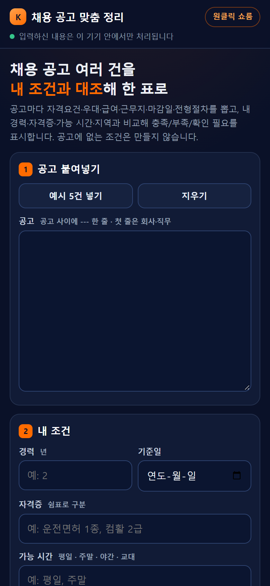
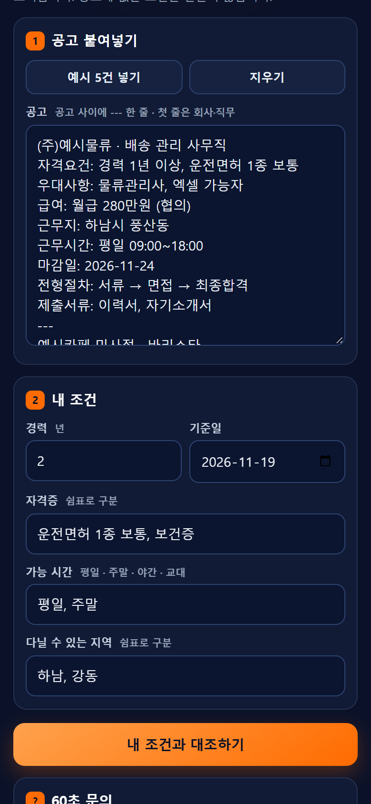
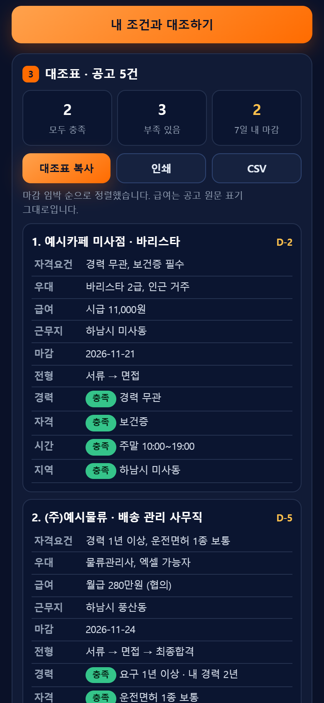

# 채용 공고 조건별 맞춤 정리 사용설명서

- 앱: `oneclick/jobfit.html` (단일 HTML · 설치 없음 · 서버 0)
- 채용 공고 여러 건을 붙여 넣으면 자격요건·우대·급여(원문)·근무지·마감일·전형을 뽑고, 내 경력·자격증·가능 시간·지역과 대조해 충족/부족/확인 필요를 표시합니다.
- 입력하신 내용은 이 기기 안에서만 처리됩니다.

## ① 누르는 곳

[예시 5건 넣기]를 누르거나, 공고 사이에 --- 한 줄을 두고 붙여 넣으세요.

## ② 입력

내 경력·자격증·가능 시간·지역을 적고 [내 조건과 대조하기]를 누릅니다.

## ③ 결과

마감 임박 순 대조표와 부족 항목 보완 문장이 나옵니다. 지원 체크리스트를 체크하고 [대조표 복사] · [인쇄] · [CSV].

## 60초 문의
화면 맨 아래 **[60초 문의 폼 열기]** 를 누르면 KTS 60초 접수 폼(`misa-1116/form.html`)이 열립니다. 이름·연락처·문의만 남기면 됩니다.

> 390px 실물 캡처: `390_jobfit.png` · 실제로 누른 자리 기록: `shots/jobfit/marks.json` · 검증 로그: `shots/jobfit/run_log.txt`