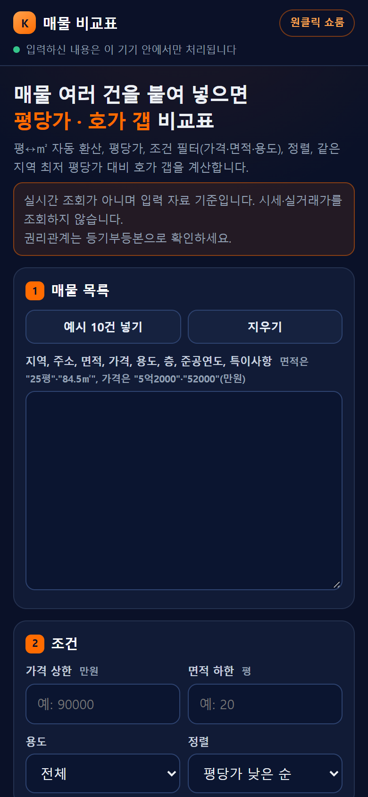
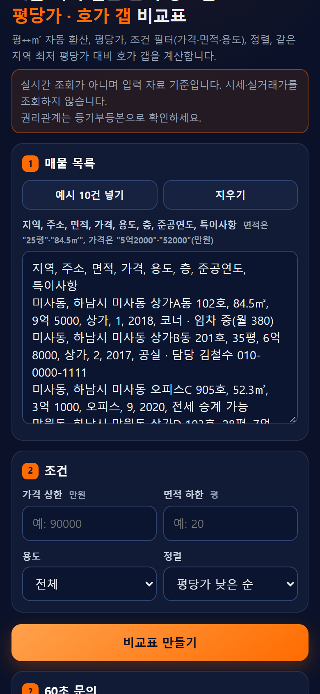
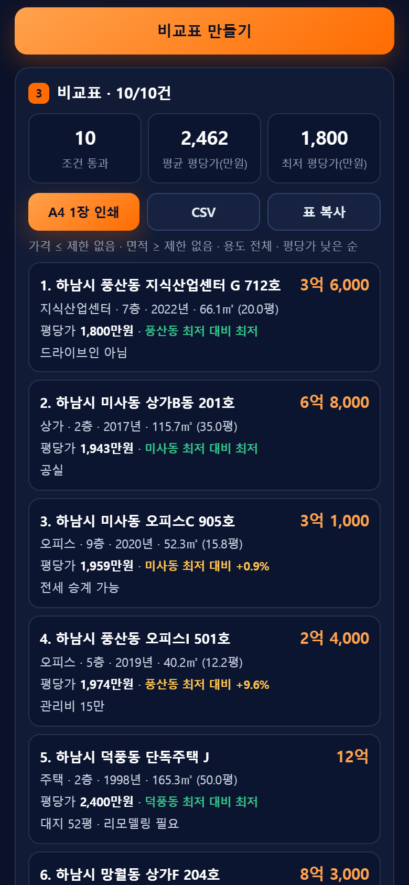

# 부동산 매물·시세 조건 필터 비교표 사용설명서

- 앱: `oneclick/listingcompare.html` (단일 HTML · 설치 없음 · 서버 0)
- 매물 여러 건(지역·주소·면적·가격·용도·층·연식·특이사항)을 붙여 넣으면 평↔㎡ 환산, 평당가, 조건 필터, 정렬, 같은 지역 최저 평당가 대비 호가 갭을 계산합니다. 입력 자료 기준이며 시세를 조회하지 않습니다.
- 입력하신 내용은 이 기기 안에서만 처리됩니다.

## ① 누르는 곳

[예시 10건 넣기]를 누르거나, 한 줄에 매물 한 건씩 붙여 넣으세요.

## ② 입력

가격 상한·면적 하한·용도·정렬을 고르고 [비교표 만들기]를 누릅니다.

## ③ 결과

평당가 순 카드와 호가 갭이 나옵니다. [A4 1장 인쇄] · [CSV] · [표 복사]로 가져가세요. 권리관계는 등기부등본으로 확인하세요.

## 60초 문의
화면 맨 아래 **[60초 문의 폼 열기]** 를 누르면 KTS 60초 접수 폼(`misa-1116/form.html`)이 열립니다. 이름·연락처·문의만 남기면 됩니다.

> 390px 실물 캡처: `390_listingcompare.png` · 실제로 누른 자리 기록: `shots/listingcompare/marks.json` · 검증 로그: `shots/listingcompare/run_log.txt`