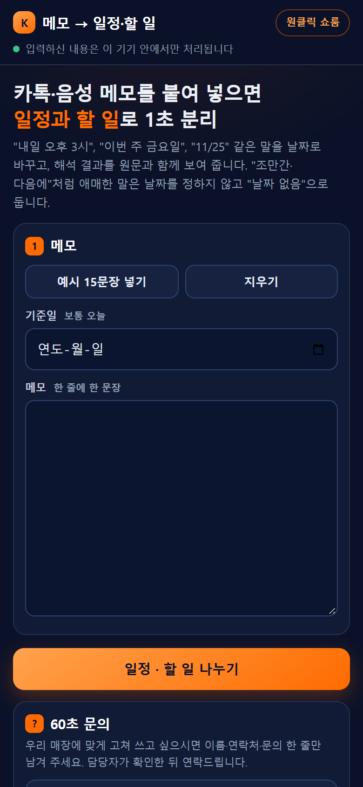
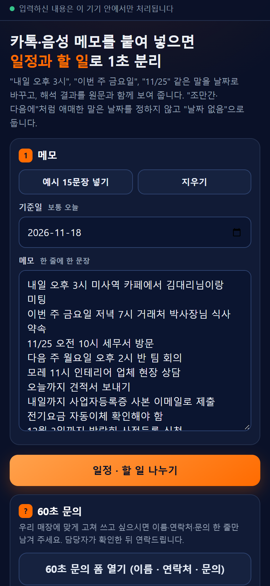
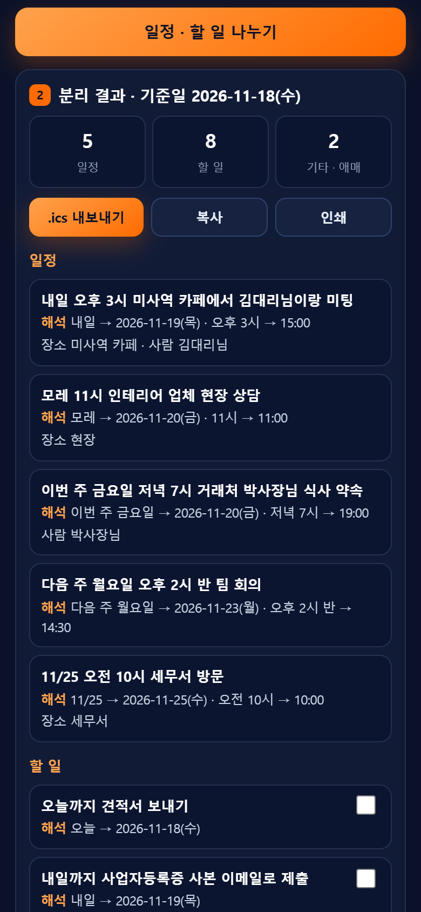

# 카톡·음성 메모 → 일정·할 일 1초 분리 사용설명서

- 앱: `oneclick/memotask.html` (단일 HTML · 설치 없음 · 서버 0)
- 카톡 대화·음성 받아쓰기를 붙여 넣으면 날짜·시간을 해석해 원문과 함께 보여 주고 일정·할 일·기타로 나눕니다. 장소·사람을 뽑고 .ics로 내보냅니다. "조만간·다음에"는 날짜 없음으로 둡니다.
- 입력하신 내용은 이 기기 안에서만 처리됩니다.

## ① 누르는 곳

[예시 15문장 넣기]를 누르거나 메모를 한 줄에 한 문장씩 붙여 넣으세요.

## ② 입력

기준일(보통 오늘)을 확인하고 [일정 · 할 일 나누기]를 누릅니다.

## ③ 결과

일정·할 일이 날짜순으로 나옵니다. 할 일은 체크하면 저장됩니다. [.ics 내보내기] · [복사] · [인쇄].

## 60초 문의
화면 맨 아래 **[60초 문의 폼 열기]** 를 누르면 KTS 60초 접수 폼(`misa-1116/form.html`)이 열립니다. 이름·연락처·문의만 남기면 됩니다.

> 390px 실물 캡처: `390_memotask.png` · 실제로 누른 자리 기록: `shots/memotask/marks.json` · 검증 로그: `shots/memotask/run_log.txt`