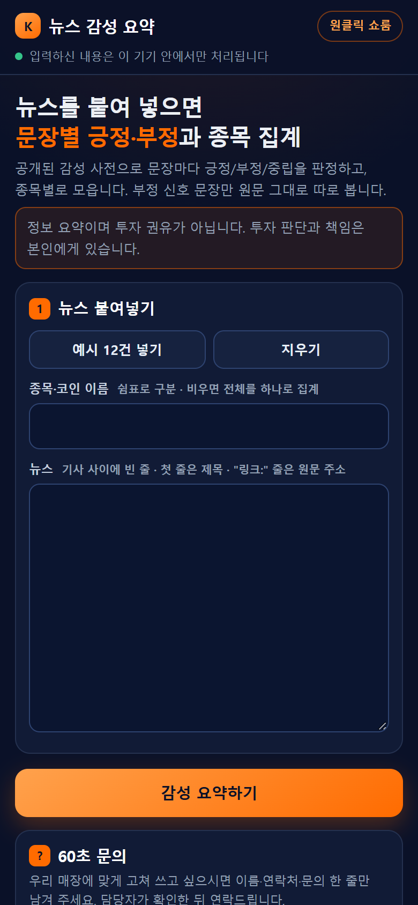
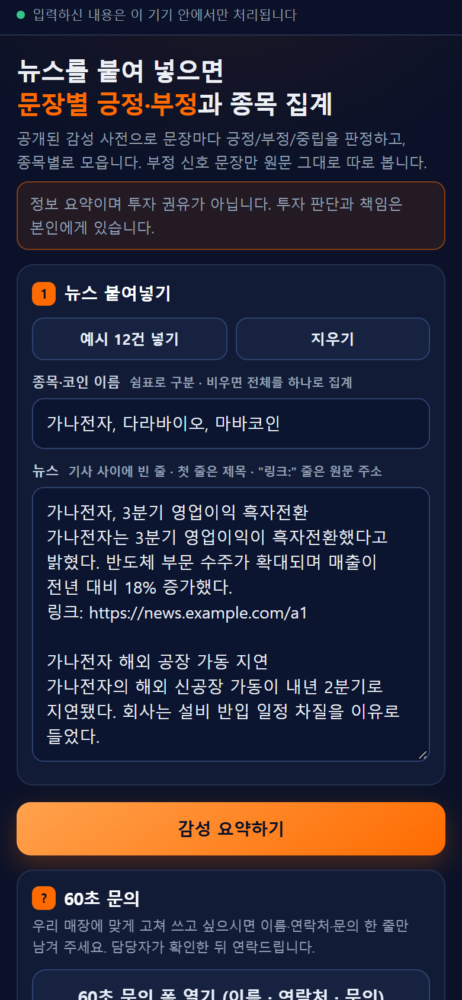
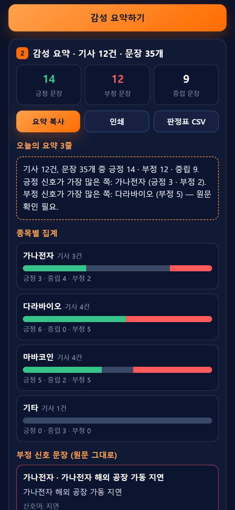

# 주식·코인 뉴스 감성 요약기 사용설명서

- 앱: `oneclick/newssentiment.html` (단일 HTML · 설치 없음 · 서버 0)
- 뉴스 제목·본문을 붙여 넣으면 공개된 감성 사전으로 문장별 긍정·부정·중립을 판정하고 종목별로 집계합니다. 부정 신호 문장만 원문 그대로 모아 봅니다. 정보 요약이며 투자 권유가 아닙니다.
- 입력하신 내용은 이 기기 안에서만 처리됩니다.

## ① 누르는 곳

[예시 12건 넣기]를 누르거나, 기사 사이에 빈 줄을 두고 붙여 넣으세요.

## ② 입력

종목·코인 이름(쉼표 구분)을 확인하고 [감성 요약하기]를 누릅니다.

## ③ 결과

요약 3줄·종목별 막대·부정 신호 문장이 나옵니다. [요약 복사] · [인쇄] · [판정표 CSV].

## 60초 문의
화면 맨 아래 **[60초 문의 폼 열기]** 를 누르면 KTS 60초 접수 폼(`misa-1116/form.html`)이 열립니다. 이름·연락처·문의만 남기면 됩니다.

> 390px 실물 캡처: `390_newssentiment.png` · 실제로 누른 자리 기록: `shots/newssentiment/marks.json` · 검증 로그: `shots/newssentiment/run_log.txt`