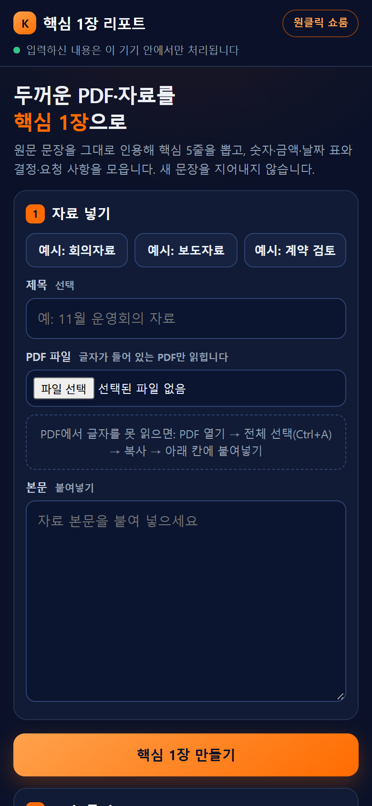
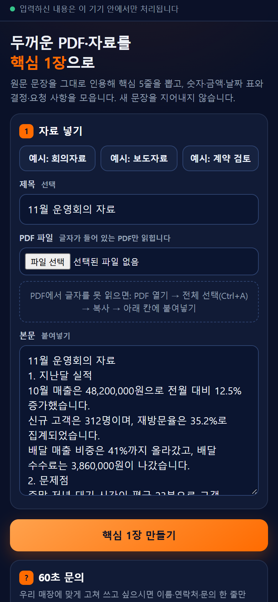
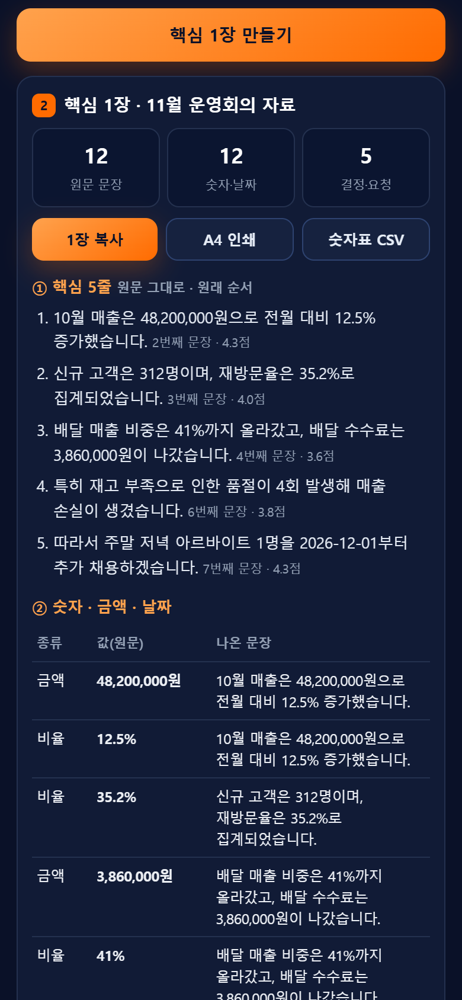

# 두꺼운 PDF → 핵심 1장 한글 리포트 사용설명서

- 앱: `oneclick/pdf1p.html` (단일 HTML · 설치 없음 · 서버 0)
- 자료를 넣으면 문장 점수로 핵심 5줄을 원문 그대로 인용하고, 금액·날짜·비율 표와 결정·요청 문장, 모르는 말 3개(풀이 빈칸)를 A4 1장으로 정리합니다.
- 입력하신 내용은 이 기기 안에서만 처리됩니다.

## ① 누르는 곳

[예시: 회의자료]를 누르세요. 내 자료는 PDF 파일을 고르거나, PDF 열기 → 전체 선택 → 복사 → 본문 칸에 붙여넣기 합니다.

## ② 입력

제목과 본문을 확인하고 [핵심 1장 만들기]를 누릅니다.

## ③ 결과

핵심 5줄·숫자표·결정 사항이 나옵니다. [1장 복사] · [A4 인쇄] · [숫자표 CSV]로 가져가세요.

## 60초 문의
화면 맨 아래 **[60초 문의 폼 열기]** 를 누르면 KTS 60초 접수 폼(`misa-1116/form.html`)이 열립니다. 이름·연락처·문의만 남기면 됩니다.

> 390px 실물 캡처: `390_pdf1p.png` · 실제로 누른 자리 기록: `shots/pdf1p/marks.json` · 검증 로그: `shots/pdf1p/run_log.txt`