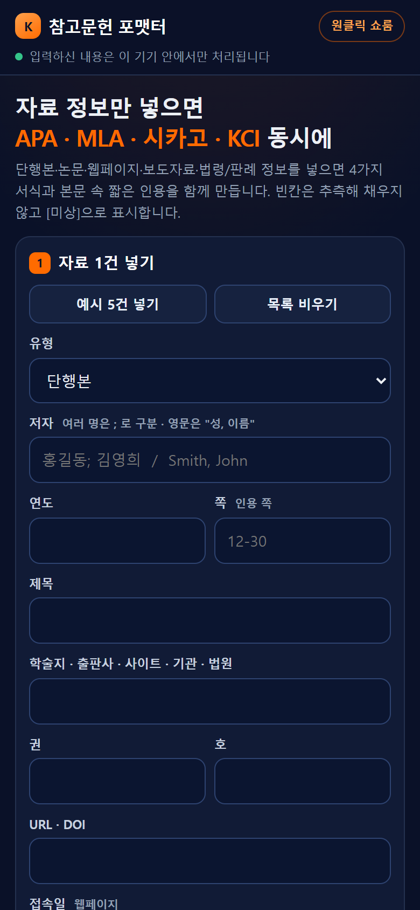
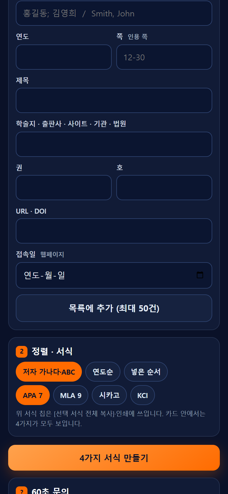
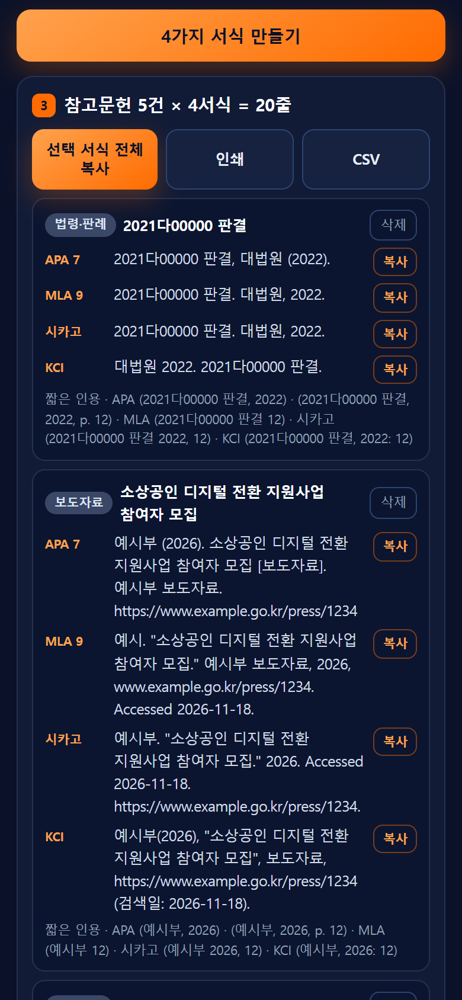

# 논문·자료 → 참고문헌 1초 포맷터 사용설명서

- 앱: `oneclick/refstyle.html` (단일 HTML · 설치 없음 · 서버 0)
- 자료 정보(저자·연도·제목·출판사 등)를 넣으면 APA 7·MLA 9·시카고·KCI 4가지 서식과 짧은 본문 인용을 동시에 만듭니다. 빈칸은 [미상]으로 표시합니다.
- 입력하신 내용은 이 기기 안에서만 처리됩니다.

## ① 누르는 곳

[예시 5건 넣기]를 누르세요. 내 자료는 유형을 고르고 칸을 채운 뒤 [목록에 추가]를 누릅니다.

## ② 입력

정렬(가나다·연도)과 복사할 서식을 고르고 [4가지 서식 만들기]를 누릅니다.

## ③ 결과

자료마다 4가지 서식이 나옵니다. 줄마다 [복사], 또는 [선택 서식 전체 복사] · [인쇄] · [CSV].

## 60초 문의
화면 맨 아래 **[60초 문의 폼 열기]** 를 누르면 KTS 60초 접수 폼(`misa-1116/form.html`)이 열립니다. 이름·연락처·문의만 남기면 됩니다.

> 390px 실물 캡처: `390_refstyle.png` · 실제로 누른 자리 기록: `shots/refstyle/marks.json` · 검증 로그: `shots/refstyle/run_log.txt`