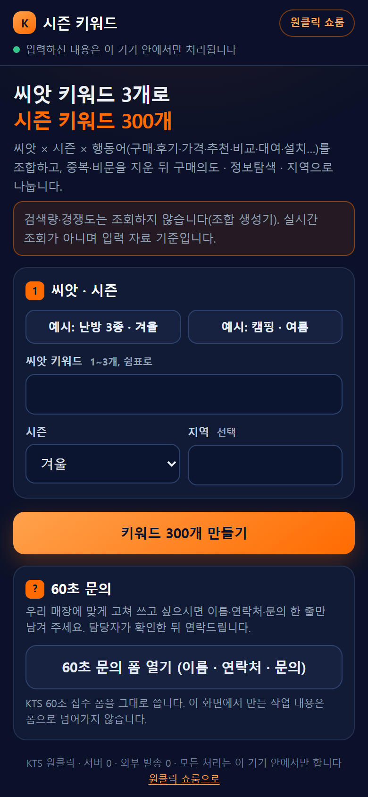
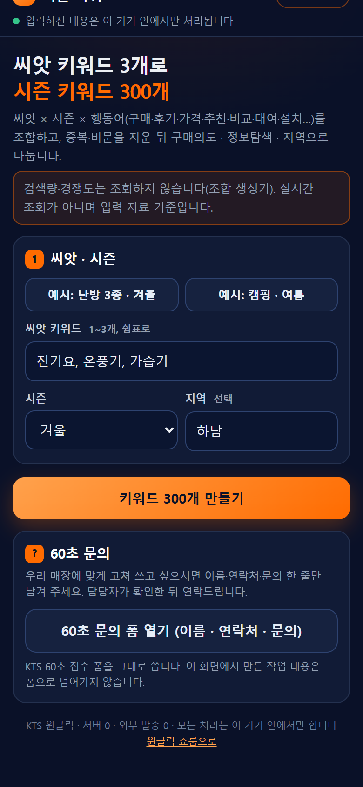
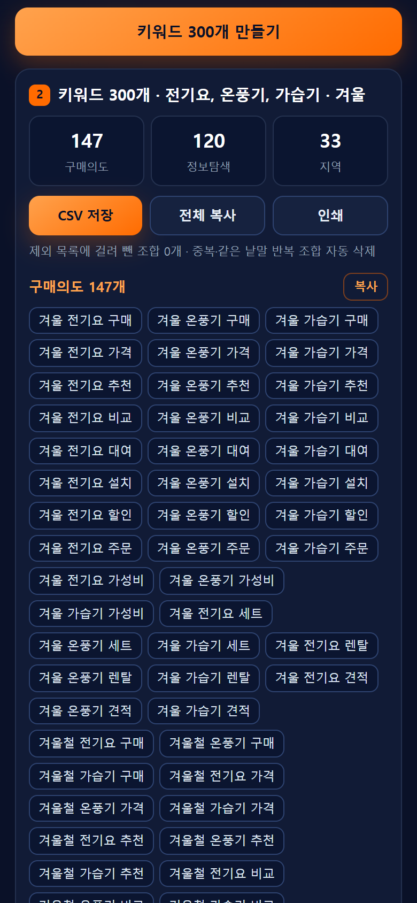

# 시즌별 키워드·연관어 추출기 사용설명서

- 앱: `oneclick/seasontrend.html` (단일 HTML · 설치 없음 · 서버 0)
- 씨앗 키워드 1~3개와 시즌·지역을 넣으면 씨앗 × 시즌어 × 행동어 조합으로 키워드 300개를 만들고 구매의도·정보탐색·지역으로 나눕니다. 검색량·경쟁도는 조회하지 않습니다(조합 생성기).
- 입력하신 내용은 이 기기 안에서만 처리됩니다.

## ① 누르는 곳

[예시: 난방 3종 · 겨울]을 누르거나 씨앗 키워드를 쉼표로 적으세요.

## ② 입력

시즌·지역을 확인하고 [키워드 300개 만들기]를 누릅니다.

## ③ 결과

그룹별 키워드가 나옵니다. 그룹마다 [복사], 전체는 [CSV 저장] · [인쇄]. 비속어·상표·의료 표현은 자동으로 빠집니다.

## 60초 문의
화면 맨 아래 **[60초 문의 폼 열기]** 를 누르면 KTS 60초 접수 폼(`misa-1116/form.html`)이 열립니다. 이름·연락처·문의만 남기면 됩니다.

> 390px 실물 캡처: `390_seasontrend.png` · 실제로 누른 자리 기록: `shots/seasontrend/marks.json` · 검증 로그: `shots/seasontrend/run_log.txt`