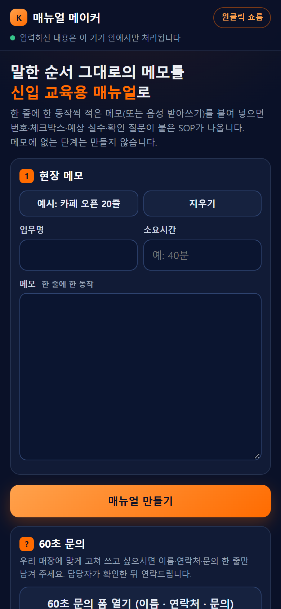
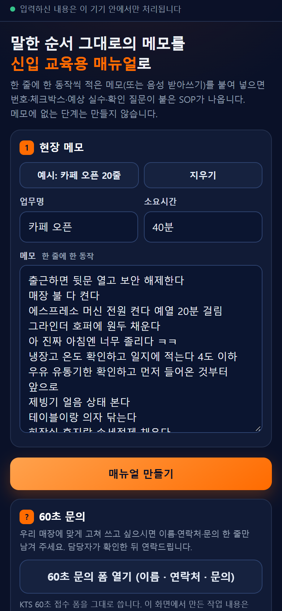
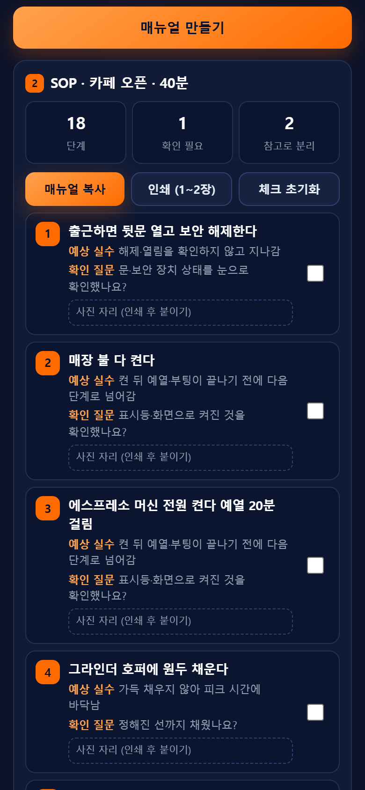

# 구술 메모 → 신입 교육용 매뉴얼(SOP) 사용설명서

- 앱: `oneclick/sopmaker.html` (단일 HTML · 설치 없음 · 서버 0)
- 현장에서 말한 순서대로 적은 메모를 번호 단계·체크박스·예상 실수·확인 질문·사진 자리가 붙은 매뉴얼로 바꿉니다. 메모에 없는 단계는 만들지 않습니다.
- 입력하신 내용은 이 기기 안에서만 처리됩니다.

## ① 누르는 곳

[예시: 카페 오픈 20줄]을 누르거나, 한 줄에 한 동작씩 메모를 붙여 넣으세요.

## ② 입력

업무명·소요시간을 확인하고 [매뉴얼 만들기]를 누릅니다.

## ③ 결과

단계별 매뉴얼이 나옵니다. 순서가 모호한 줄은 "확인 필요", 잡담은 "참고"로 빠집니다. [인쇄]해서 신입에게 주고 교육 일지를 남기세요.

## 60초 문의
화면 맨 아래 **[60초 문의 폼 열기]** 를 누르면 KTS 60초 접수 폼(`misa-1116/form.html`)이 열립니다. 이름·연락처·문의만 남기면 됩니다.

> 390px 실물 캡처: `390_sopmaker.png` · 실제로 누른 자리 기록: `shots/sopmaker/marks.json` · 검증 로그: `shots/sopmaker/run_log.txt`