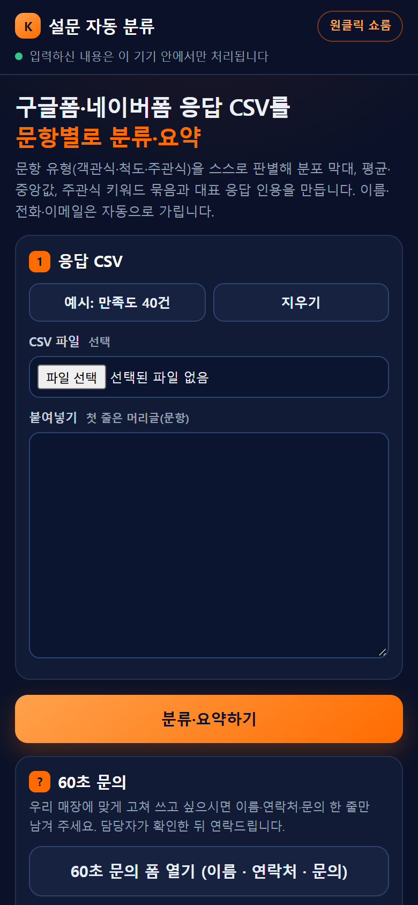
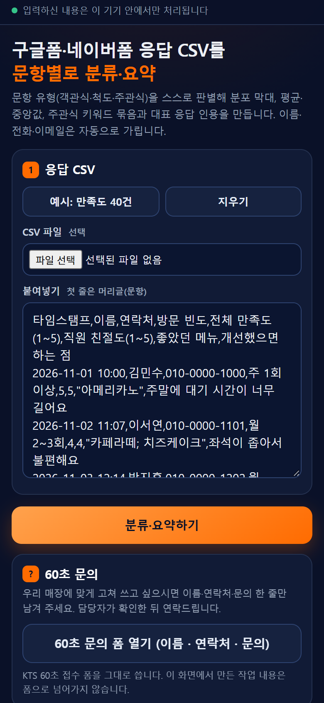
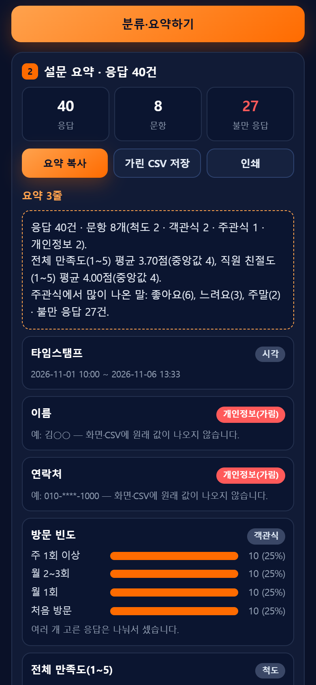

# 구글폼·네이버폼 설문 응답 자동 분류·요약 사용설명서

- 앱: `oneclick/surveyclassify.html` (단일 HTML · 설치 없음 · 서버 0)
- 응답 CSV를 넣으면 문항 유형(객관식·척도·주관식)을 판별해 분포 막대, 평균·중앙값, 주관식 키워드 묶음과 대표 응답 인용, 불만 응답 모음, 요약 3줄을 만듭니다. 이름·전화·이메일은 자동으로 가립니다.
- 입력하신 내용은 이 기기 안에서만 처리됩니다.

## ① 누르는 곳

[예시: 만족도 40건]을 누르거나, CSV 파일을 고르거나 붙여 넣으세요(첫 줄 머리글).

## ② 입력

붙여 넣은 응답을 확인하고 [분류·요약하기]를 누릅니다.

## ③ 결과

문항별 요약과 불만 응답이 나옵니다. [요약 복사] · [가린 CSV 저장] · [인쇄].

## 60초 문의
화면 맨 아래 **[60초 문의 폼 열기]** 를 누르면 KTS 60초 접수 폼(`misa-1116/form.html`)이 열립니다. 이름·연락처·문의만 남기면 됩니다.

> 390px 실물 캡처: `390_surveyclassify.png` · 실제로 누른 자리 기록: `shots/surveyclassify/marks.json` · 검증 로그: `shots/surveyclassify/run_log.txt`