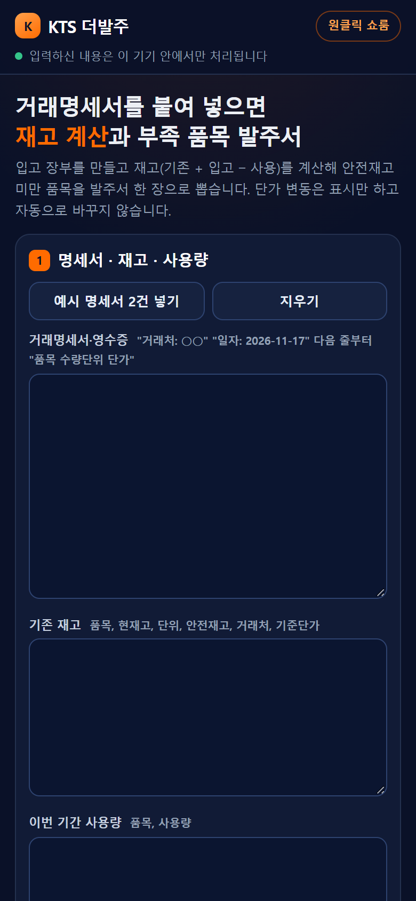
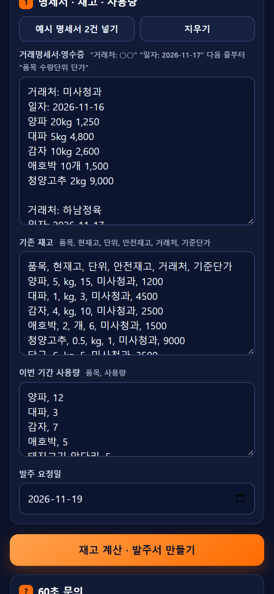
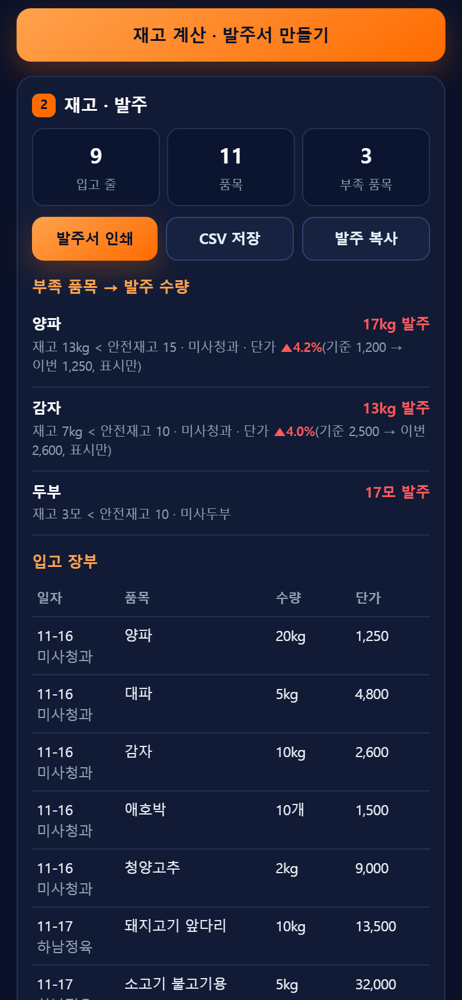

# KTS 더발주 — 입고 · 재고 + 부족 품목 발주서 사용설명서

- 앱: `oneclick/balju.html` (단일 HTML · 설치 없음 · 서버 0)
- 거래명세서·영수증 텍스트(거래처·일자·품목·수량·단가)와 기존 재고·사용량을 넣으면 입고 장부를 만들고 재고(기존 + 입고 − 사용)를 계산해 안전재고 미만 품목의 발주서를 거래처별로 뽑습니다. 단가 변동은 표시만 하고, 단위가 다르면 "확인"으로 둡니다.
- 입력하신 내용은 이 기기 안에서만 처리됩니다.

## ① 누르는 곳

[예시 명세서 2건 넣기]를 누르거나 명세서를 붙여 넣으세요.

## ② 입력

기존 재고(안전재고 포함)와 사용량, 발주 요청일을 확인하고 [재고 계산 · 발주서 만들기]를 누릅니다.

## ③ 결과

부족 품목과 발주 수량이 나옵니다. [발주서 인쇄]로 한 장을 뽑고, [발주 복사] · [CSV 저장]으로 보관하세요. 전송은 직접 합니다.

## 60초 문의
화면 맨 아래 **[60초 문의 폼 열기]** 를 누르면 KTS 60초 접수 폼(`misa-1116/form.html`)이 열립니다. 이름·연락처·문의만 남기면 됩니다.

> 390px 실물 캡처: `390_balju.png` · 실제로 누른 자리 기록: `shots/balju/marks.json` · 검증 로그: `shots/balju/run_log.txt`