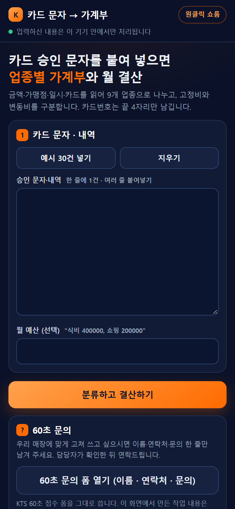
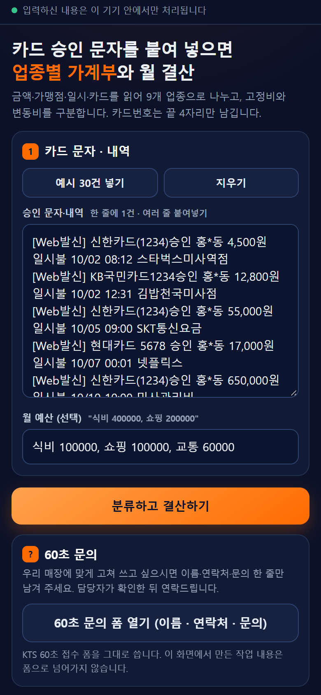
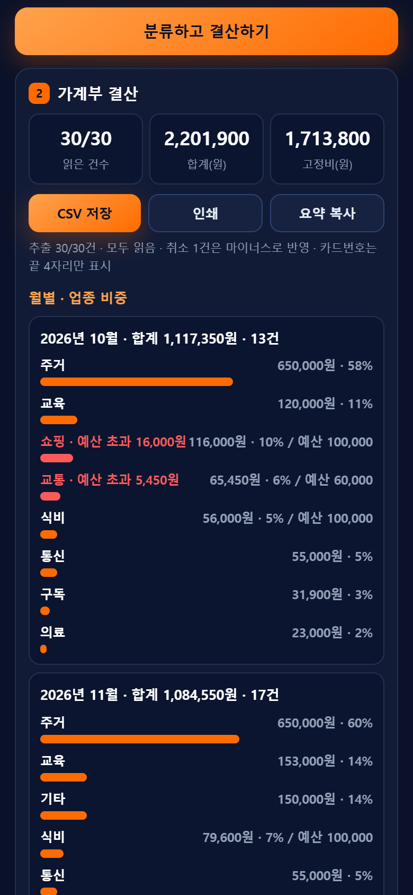

# 카드 사용 문자 → 가계부 자동 분류·결산 사용설명서

- 앱: `oneclick/cardbook.html` (단일 HTML · 설치 없음 · 서버 0)
- 카드 승인 문자·내역을 붙여 넣으면 금액·가맹점·일시·카드를 읽어 9개 업종(식비·교통·통신·주거·의료·교육·쇼핑·구독·기타)으로 나누고, 월 합계·업종 비중·고정비/변동비·예산 초과를 보여 줍니다. 카드번호는 끝 4자리만 남깁니다.
- 입력하신 내용은 이 기기 안에서만 처리됩니다.

## ① 누르는 곳

[예시 30건 넣기]를 누르거나, 카드 승인 문자를 여러 줄 그대로 붙여 넣으세요.

## ② 입력

월 예산(선택, "식비 400000")을 적고 [분류하고 결산하기]를 누릅니다.

## ③ 결과

월별 업종 비중과 예산 초과가 나옵니다. 업종이 틀리면 내역에서 바꾸세요(같은 가맹점은 다음부터 자동). [CSV 저장] · [인쇄] · [요약 복사].

## 60초 문의
화면 맨 아래 **[60초 문의 폼 열기]** 를 누르면 KTS 60초 접수 폼(`misa-1116/form.html`)이 열립니다. 이름·연락처·문의만 남기면 됩니다.

> 390px 실물 캡처: `390_cardbook.png` · 실제로 누른 자리 기록: `shots/cardbook/marks.json` · 검증 로그: `shots/cardbook/run_log.txt`