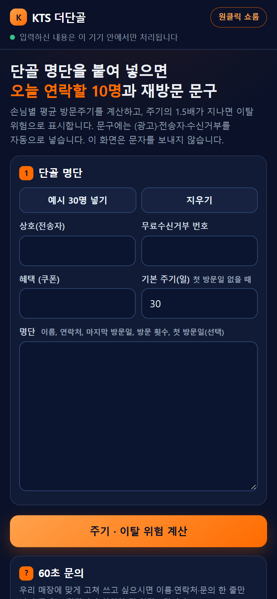
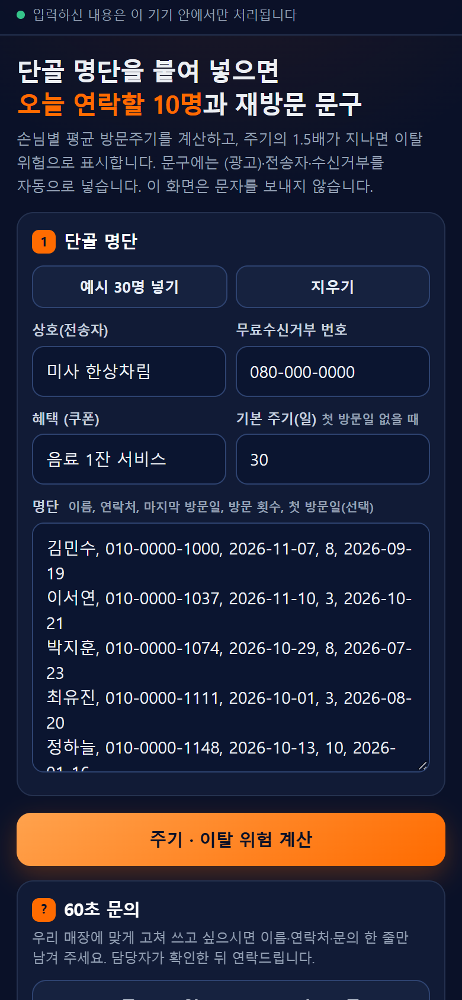
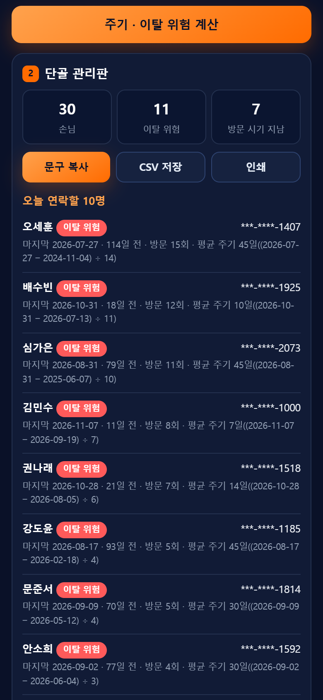

# KTS 더단골 — 방문주기 · 이탈 위험 · 재방문 안내문 사용설명서

- 앱: `oneclick/dangol.html` (단일 HTML · 설치 없음 · 서버 0)
- POS·카톡 단골 명단(이름·연락처·마지막 방문일·방문 횟수·첫 방문일)을 붙여 넣으면 손님별 평균 방문주기를 계산해 주기의 1.5배가 지난 손님을 이탈 위험으로 표시하고, 오늘 연락할 10명과 재방문 문구 3종을 만듭니다. 문구에는 (광고)·전송자·무료수신거부가 자동으로 들어가고, 연락처는 끝 4자리만 보입니다. 발송은 하지 않습니다.
- 입력하신 내용은 이 기기 안에서만 처리됩니다.

## ① 누르는 곳

[예시 30명 넣기]를 누르거나 명단을 붙여 넣으세요. 상호·수신거부 번호·혜택을 적습니다.

## ② 입력

명단을 확인하고 [주기 · 이탈 위험 계산]을 누릅니다.

## ③ 결과

오늘 연락할 10명과 문구 3종(재방문 쿠폰·오랜만 안부·단골 감사)이 나옵니다. [문구 복사]로 직접 보내고, [CSV 저장] · [인쇄]로 관리하세요.

## 60초 문의
화면 맨 아래 **[60초 문의 폼 열기]** 를 누르면 KTS 60초 접수 폼(`misa-1116/form.html`)이 열립니다. 이름·연락처·문의만 남기면 됩니다.

> 390px 실물 캡처: `390_dangol.png` · 실제로 누른 자리 기록: `shots/dangol/marks.json` · 검증 로그: `shots/dangol/run_log.txt`