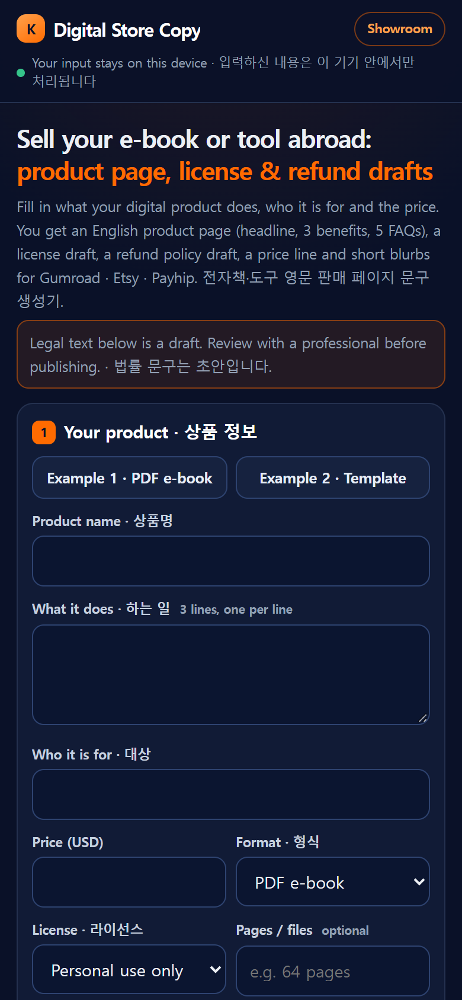
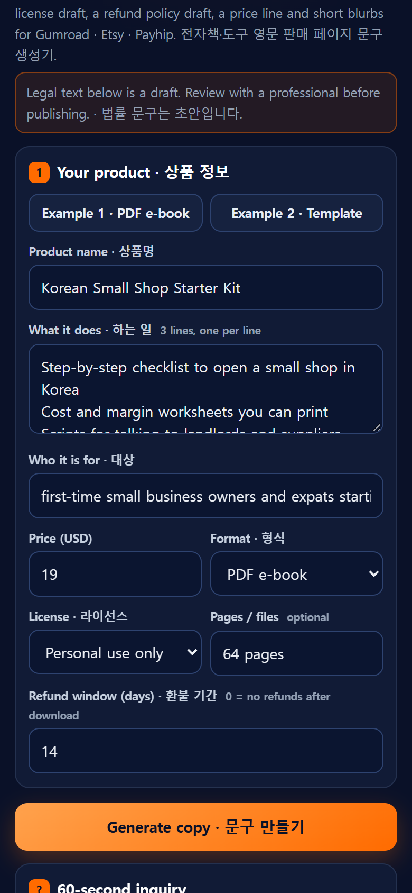
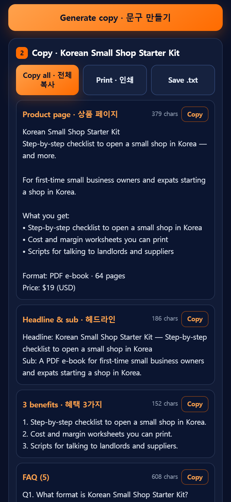

# Digital Product Page Copy Generator (전자책·도구 영문 판매 문구) 사용설명서

- 앱: `oneclick/digitalstore_en.html` (단일 HTML · 설치 없음 · 서버 0)
- 상품명·하는 일 3줄·대상·가격·형식·라이선스를 넣으면 영문 상품 페이지(헤드라인·혜택 3·FAQ 5), 라이선스 초안, 환불 정책 초안, 가격 표시, Gumroad·Etsy·Payhip용 짧은 설명 2종을 만듭니다. Review with a professional before publishing.
- 입력하신 내용은 이 기기 안에서만 처리됩니다.

## ① 누르는 곳

[Example 1 · PDF e-book] 또는 [Example 2 · Template]를 누르세요.

## ② 입력

하는 일 3줄·라이선스·환불 기간을 확인하고 [Generate copy]를 누릅니다.

## ③ 결과

블록 9개가 나옵니다. 노란 [괄호]는 직접 채울 칸입니다. 블록별 [Copy] · [Copy all] · [Save .txt] · [Print]. 업로드·결제는 하지 않습니다.

## 60초 문의
화면 맨 아래 **[60초 문의 폼 열기]** 를 누르면 KTS 60초 접수 폼(`misa-1116/form.html`)이 열립니다. 이름·연락처·문의만 남기면 됩니다.

> 390px 실물 캡처: `390_digitalstore_en.png` · 실제로 누른 자리 기록: `shots/digitalstore_en/marks.json` · 검증 로그: `shots/digitalstore_en/run_log.txt`