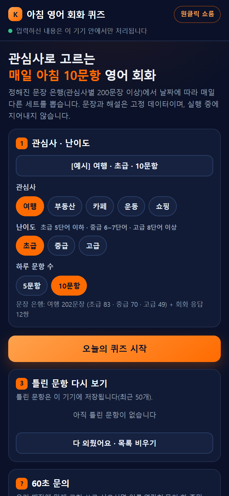
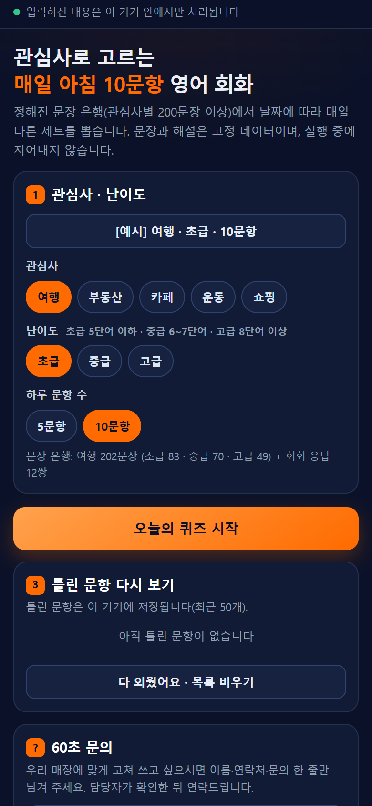
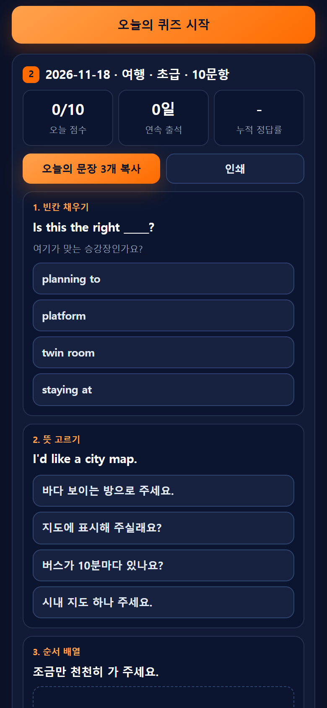

# 관심사 맞춤 아침 영어 회화 퀴즈 사용설명서

- 앱: `oneclick/engquiz.html` (단일 HTML · 설치 없음 · 서버 0)
- 관심사(여행·부동산·카페·운동·쇼핑)와 난이도를 고르면 고정 문장 은행(관심사별 200문장 이상)에서 날짜별로 다른 10문항(빈칸·뜻 고르기·순서 배열·짧은 회화 응답)이 나옵니다. 정답·해설 1줄·발음 표기, 틀린 문항 다시 보기, 연속 출석일·정답률이 이 기기에 저장됩니다.
- 입력하신 내용은 이 기기 안에서만 처리됩니다.

## ① 누르는 곳

[예시] 여행 · 초급 · 10문항 단추를 누르거나, 관심사·난이도·문항 수를 고르세요.

## ② 입력

고른 조합을 확인하고 [오늘의 퀴즈 시작]을 누릅니다.

## ③ 결과

문항마다 답을 누르면 정답·해설·발음이 바로 나옵니다. 다 풀면 점수·연속 출석일이 저장되고, [오늘의 문장 3개 복사]로 메모해 두세요.

## 60초 문의
화면 맨 아래 **[60초 문의 폼 열기]** 를 누르면 KTS 60초 접수 폼(`misa-1116/form.html`)이 열립니다. 이름·연락처·문의만 남기면 됩니다.

> 390px 실물 캡처: `390_engquiz.png` · 실제로 누른 자리 기록: `shots/engquiz/marks.json` · 검증 로그: `shots/engquiz/run_log.txt`