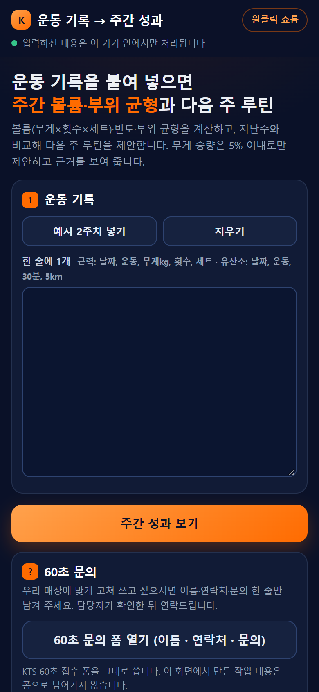
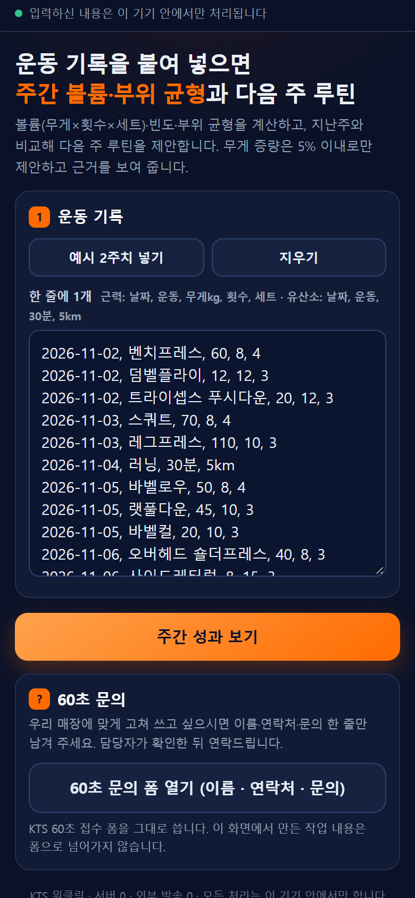
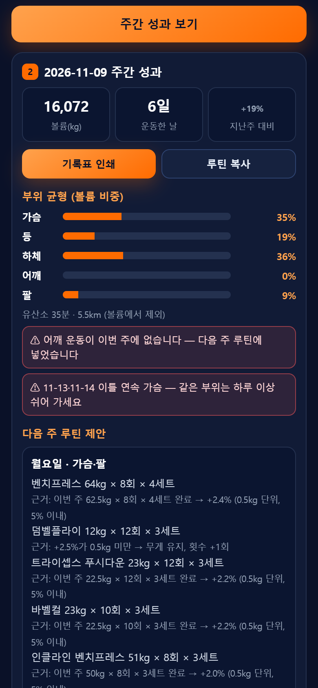

# 운동 기록 → 주간 성과 · 다음 주 루틴 사용설명서

- 앱: `oneclick/fitnessweek.html` (단일 HTML · 설치 없음 · 서버 0)
- 운동 기록(날짜·운동·무게·횟수·세트 / 유산소 시간·거리)을 붙여 넣으면 주간 볼륨·운동일·부위 균형과 지난주 대비 증감을 계산하고, 같은 부위 몰림·이틀 연속·과훈련(볼륨 20% 초과 증가)을 경고합니다. 다음 주 무게는 5% 이내로만 제안하고 근거를 보여 줍니다.
- 입력하신 내용은 이 기기 안에서만 처리됩니다.

## ① 누르는 곳

[예시 2주치 넣기]를 누르거나 "2026-11-10, 벤치프레스, 60, 8, 4"처럼 한 줄에 하나씩 적으세요.

## ② 입력

기록을 확인하고 [주간 성과 보기]를 누릅니다.

## ③ 결과

볼륨·부위 균형·경고와 다음 주 요일별 루틴이 나옵니다. [기록표 인쇄] · [루틴 복사]. 통증·부상은 전문가와 상담하세요.

## 60초 문의
화면 맨 아래 **[60초 문의 폼 열기]** 를 누르면 KTS 60초 접수 폼(`misa-1116/form.html`)이 열립니다. 이름·연락처·문의만 남기면 됩니다.

> 390px 실물 캡처: `390_fitnessweek.png` · 실제로 누른 자리 기록: `shots/fitnessweek/marks.json` · 검증 로그: `shots/fitnessweek/run_log.txt`