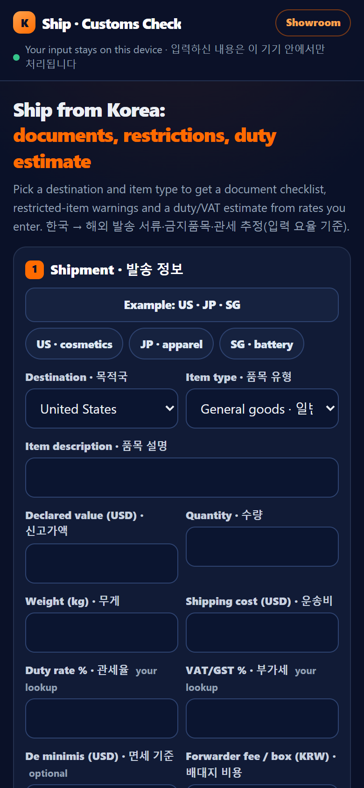
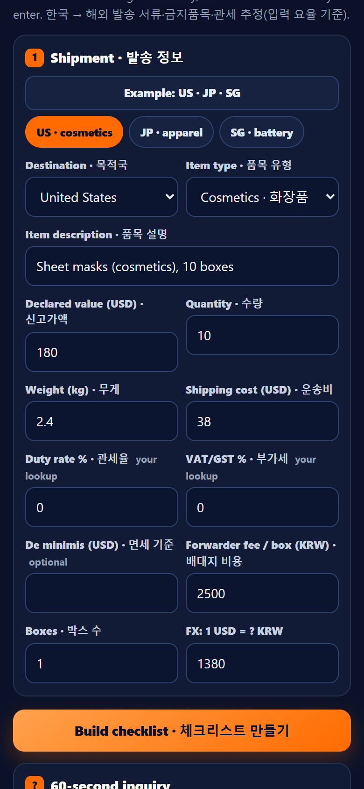
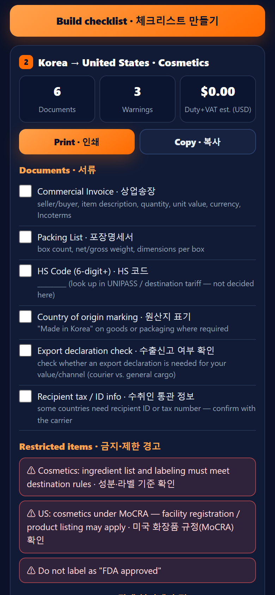

# 한국 → 해외 발송·통관 체크리스트 (한/영) 사용설명서

- 앱: `oneclick/globalship.html` (단일 HTML · 설치 없음 · 서버 0)
- 목적국(US·EU·JP·SG·MY·VN)·품목 유형·신고가액·무게·수량을 넣으면 서류 체크리스트, 금지·제한 품목 경고, 입력한 요율로만 계산하는 관세·VAT 추정, 배대지 비용 대조표를 만듭니다. This is a checklist, not customs advice.
- 입력하신 내용은 이 기기 안에서만 처리됩니다.

## ① 누르는 곳

[Example US]를 누르거나 목적국·품목을 고르세요(JP·SG 예시 단추도 있음).

## ② 입력

관세율·부가세율(UNIPASS 등에서 직접 확인한 값)과 배대지 비용을 넣고 [Build checklist]를 누릅니다.

## ③ 결과

서류 체크리스트·경고·추정액이 나옵니다. [Print]로 포장할 때 체크하고 [Copy]로 메모하세요.

## 60초 문의
화면 맨 아래 **[60초 문의 폼 열기]** 를 누르면 KTS 60초 접수 폼(`misa-1116/form.html`)이 열립니다. 이름·연락처·문의만 남기면 됩니다.

> 390px 실물 캡처: `390_globalship.png` · 실제로 누른 자리 기록: `shots/globalship/marks.json` · 검증 로그: `shots/globalship/run_log.txt`