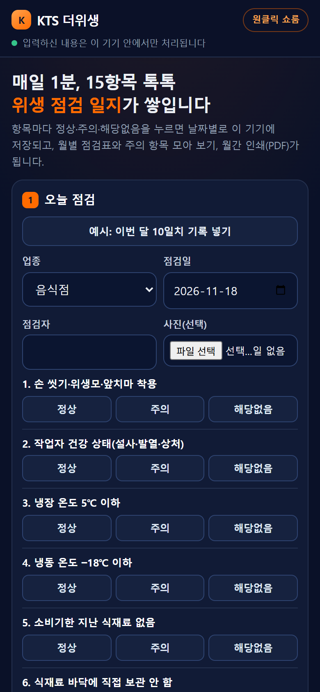
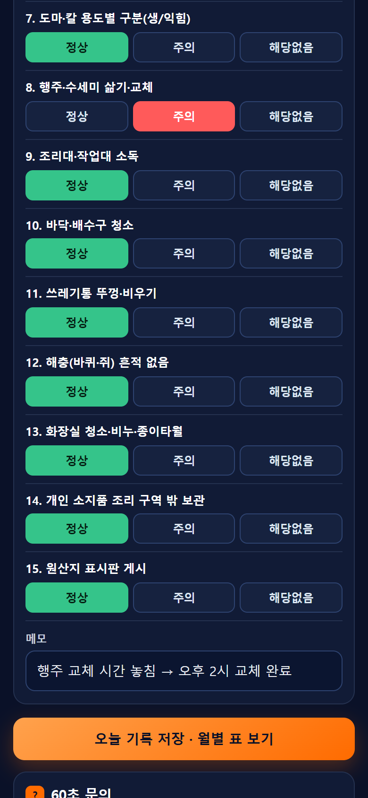
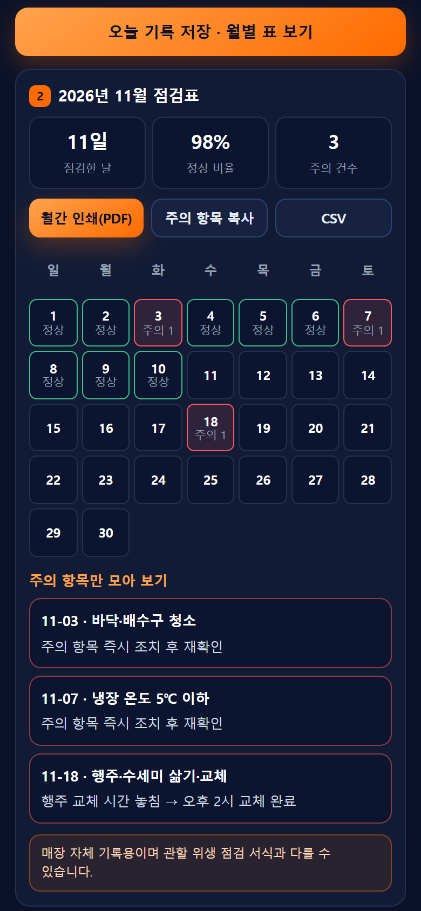

# KTS 더위생 — 매일 1분 위생 점검 일지 사용설명서

- 앱: `oneclick/hygiene.html` (단일 HTML · 설치 없음 · 서버 0)
- 업종(음식점·카페·제과)별 15항목을 정상·주의·해당없음으로 누르면 날짜별로 이 기기에 저장되고, 월별 달력·주의 항목 모아 보기·월간 점검표 인쇄(PDF)가 됩니다. 사진 1장을 함께 남길 수 있습니다. 매장 자체 기록용이며 관할 위생 점검 서식과 다를 수 있습니다.
- 입력하신 내용은 이 기기 안에서만 처리됩니다.

## ① 누르는 곳

처음이면 [예시: 이번 달 10일치 기록 넣기]를 누르세요. 업종·점검일·점검자를 고릅니다.

## ② 입력

15항목을 하나씩 누르고(정상·주의·해당없음) 메모를 적은 뒤 [오늘 기록 저장 · 월별 표 보기]를 누릅니다.

## ③ 결과

이번 달 달력과 주의 항목이 나옵니다. [월간 인쇄(PDF)]로 점검표를 뽑아 보관하세요. 기록은 새로고침해도 남습니다.

## 60초 문의
화면 맨 아래 **[60초 문의 폼 열기]** 를 누르면 KTS 60초 접수 폼(`misa-1116/form.html`)이 열립니다. 이름·연락처·문의만 남기면 됩니다.

> 390px 실물 캡처: `390_hygiene.png` · 실제로 누른 자리 기록: `shots/hygiene/marks.json` · 검증 로그: `shots/hygiene/run_log.txt`