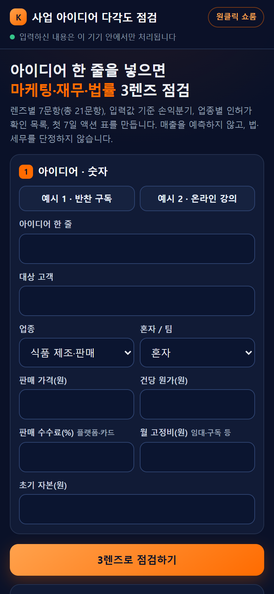
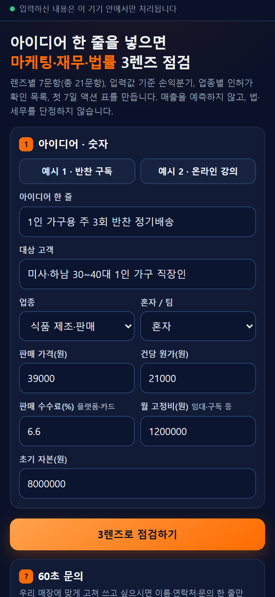
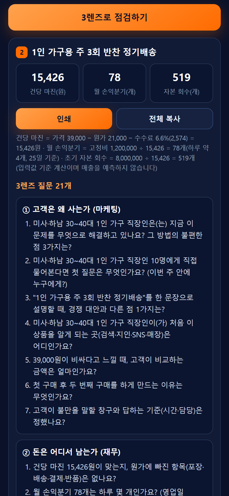

# 사업 아이디어 → 마케팅·재무·법률 다각도 점검 사용설명서

- 앱: `oneclick/ideaboard.html` (단일 HTML · 설치 없음 · 서버 0)
- 아이디어 한 줄과 대상 고객·가격·원가·수수료·고정비·초기 자본을 넣으면 3렌즈 질문 21개, 건당 마진·월 손익분기·자본 회수 판매량, 업종별 인허가 확인 목록, 첫 7일 액션 표가 나옵니다. 매출은 예측하지 않고, 법·세무는 "확인 필요"로만 씁니다.
- 입력하신 내용은 이 기기 안에서만 처리됩니다.

## ① 누르는 곳

[예시 1 · 반찬 구독] 또는 [예시 2 · 온라인 강의]를 누르세요.

## ② 입력

숫자(가격·원가·수수료·고정비·초기 자본)를 확인하고 [3렌즈로 점검하기]를 누릅니다.

## ③ 결과

손익분기 계산식과 질문 21개, 확인 목록, 7일 액션이 나옵니다. [인쇄]해서 메모하며 답해 보세요.

## 60초 문의
화면 맨 아래 **[60초 문의 폼 열기]** 를 누르면 KTS 60초 접수 폼(`misa-1116/form.html`)이 열립니다. 이름·연락처·문의만 남기면 됩니다.

> 390px 실물 캡처: `390_ideaboard.png` · 실제로 누른 자리 기록: `shots/ideaboard/marks.json` · 검증 로그: `shots/ideaboard/run_log.txt`