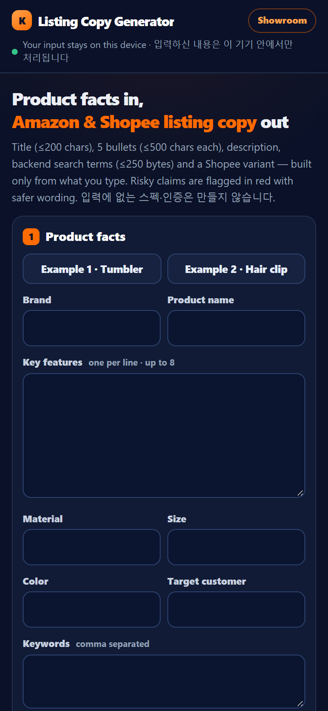
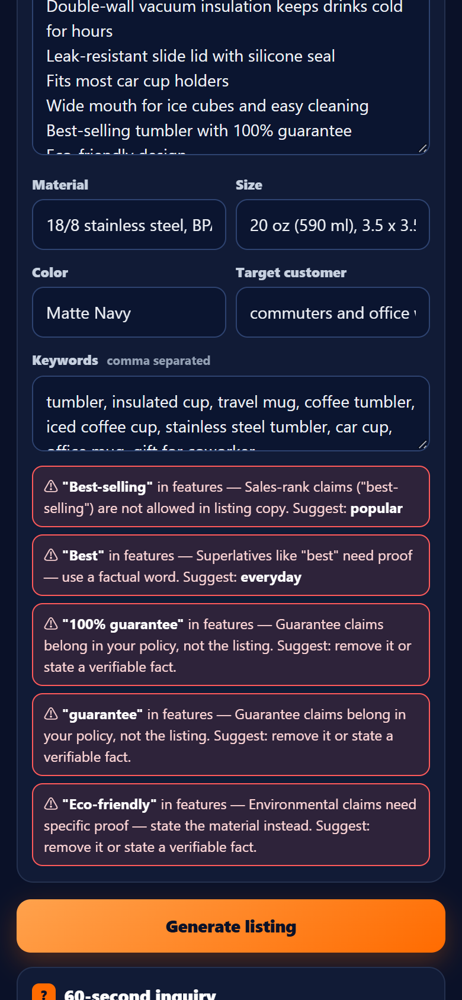
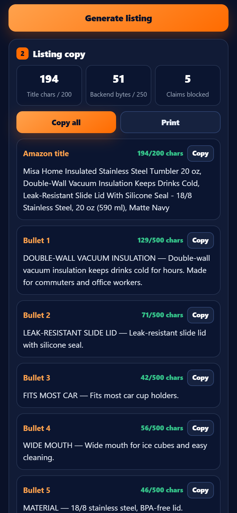

# Listing Copy Generator (영문 상품 등록 문구) 사용설명서

- 앱: `oneclick/listinggen_en.html` (단일 HTML · 설치 없음 · 서버 0)
- 상품명·특징(최대 8)·재질/크기/색·대상·키워드를 넣으면 아마존 제목(200자 이내)·불릿 5개·설명 3문단·백엔드 검색어(250바이트 이내)·쇼피용 문구를 만듭니다. best·cure·FDA approved·100% guarantee 같은 금지 표현은 빨간색으로 막고 대체어를 제안합니다.
- 입력하신 내용은 이 기기 안에서만 처리됩니다.

## ① 누르는 곳

[Example 1 · Tumbler]를 누르거나 상품 정보를 영어로 넣으세요.

## ② 입력

특징과 키워드를 확인하고 [Generate listing]을 누릅니다.

## ③ 결과

블록마다 글자 수/바이트 수가 표시됩니다. 블록별 [Copy] 또는 전체 복사. 입력에 없는 스펙·인증은 만들지 않습니다.

## 60초 문의
화면 맨 아래 **[60초 문의 폼 열기]** 를 누르면 KTS 60초 접수 폼(`misa-1116/form.html`)이 열립니다. 이름·연락처·문의만 남기면 됩니다.

> 390px 실물 캡처: `390_listinggen_en.png` · 실제로 누른 자리 기록: `shots/listinggen_en/marks.json` · 검증 로그: `shots/listinggen_en/run_log.txt`