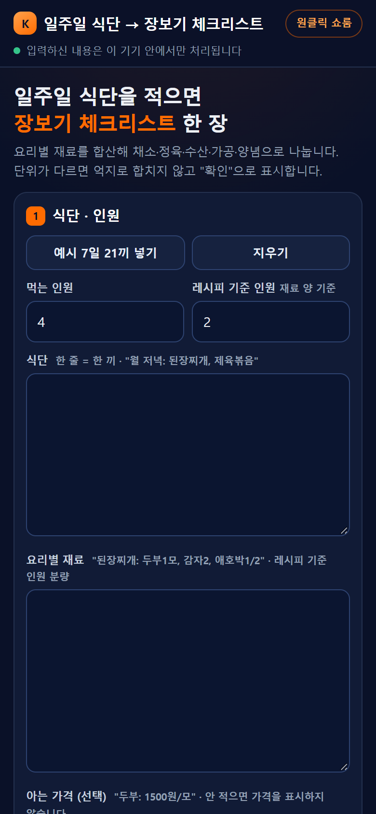
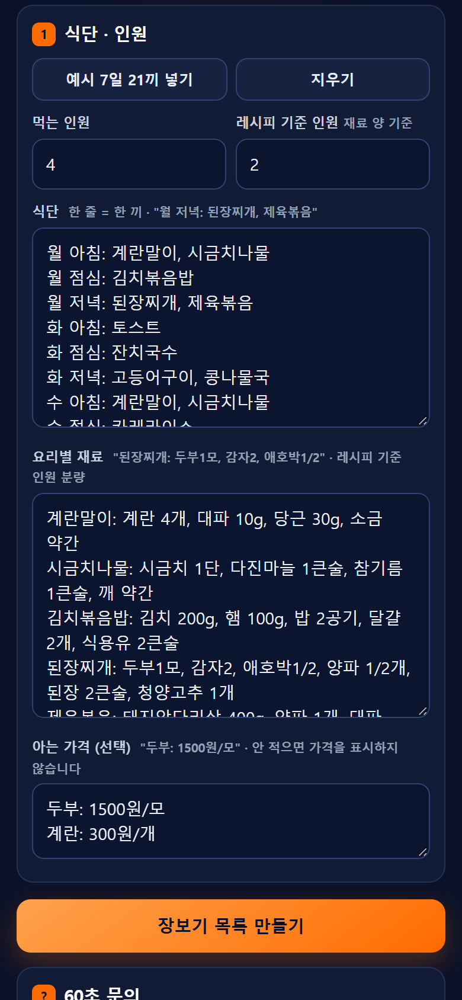
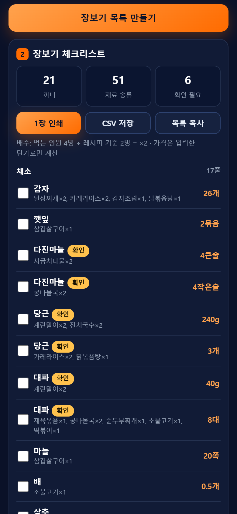

# 일주일 식단 → 장보기 체크리스트 사용설명서

- 앱: `oneclick/mealplan.html` (단일 HTML · 설치 없음 · 서버 0)
- 일주일 식단과 요리별 재료를 적으면 같은 재료를 합산해 채소·정육·수산·가공·양념으로 나눈 장보기 체크리스트가 나옵니다. 단위가 다른 재료(예: 당근 g·개)는 억지로 환산하지 않고 "확인"으로 표시하고, 가격은 입력한 단가가 있을 때만 계산합니다.
- 입력하신 내용은 이 기기 안에서만 처리됩니다.

## ① 누르는 곳

[예시 7일 21끼 넣기]를 누르세요. 내 식단이면 "월 저녁: 된장찌개, 제육볶음"처럼 한 줄에 한 끼씩 적습니다.

## ② 입력

먹는 인원·레시피 기준 인원과 요리별 재료("된장찌개: 두부1모, 감자2, 애호박1/2")를 확인하고 [장보기 목록 만들기]를 누릅니다.

## ③ 결과

분류별 체크리스트가 나옵니다. 장 보면서 체크하면 이 기기에 저장됩니다. [1장 인쇄] · [CSV 저장] · [목록 복사]로 가져가세요.

## 60초 문의
화면 맨 아래 **[60초 문의 폼 열기]** 를 누르면 KTS 60초 접수 폼(`misa-1116/form.html`)이 열립니다. 이름·연락처·문의만 남기면 됩니다.

> 390px 실물 캡처: `390_mealplan.png` · 실제로 누른 자리 기록: `shots/mealplan/marks.json` · 검증 로그: `shots/mealplan/run_log.txt`