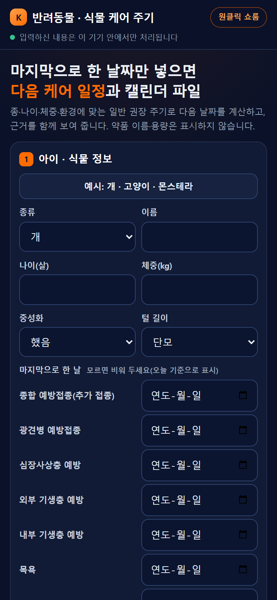
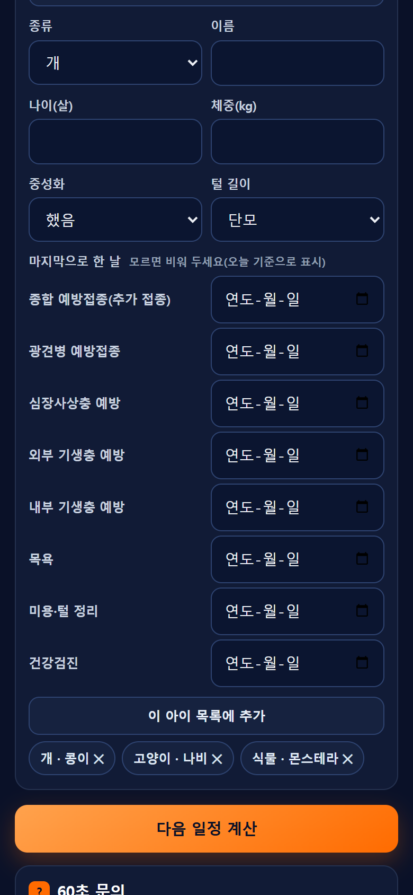
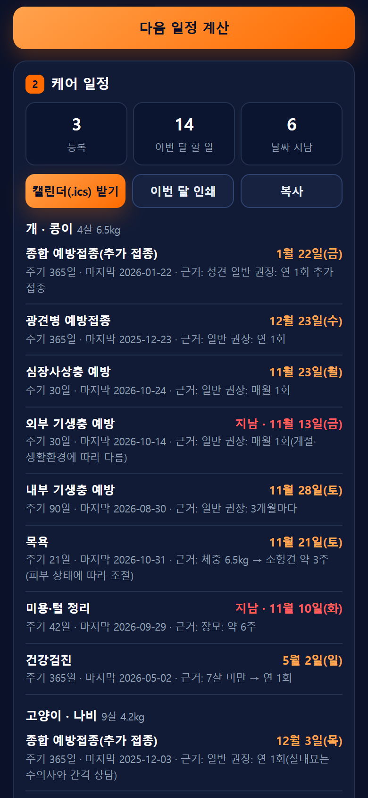

# 반려동물·식물 케어 주기 계산 · 리마인드 사용설명서

- 앱: `oneclick/petcare.html` (단일 HTML · 설치 없음 · 서버 0)
- 개·고양이(나이·체중·중성화·털 길이)나 관엽식물(위치·햇빛)과 마지막으로 한 날짜를 넣으면 예방접종·구충·목욕·미용·검진 / 물 주기·비료·분갈이·가지치기의 다음 날짜와 근거를 보여 주고, 캘린더(.ics) 파일로 내보냅니다. 약품 이름·용량은 표시하지 않습니다.
- 입력하신 내용은 이 기기 안에서만 처리됩니다.

## ① 누르는 곳

[예시: 개 · 고양이 · 몬스테라]를 누르세요. 내 아이면 종류·이름·나이를 넣고 [이 아이 목록에 추가]를 누릅니다.

## ② 입력

마지막으로 한 날짜를 확인하고 [다음 일정 계산]을 누릅니다.

## ③ 결과

아이별 다음 일정과 근거가 나옵니다. [캘린더(.ics) 받기]로 휴대폰 달력에 넣고, [이번 달 인쇄]로 냉장고에 붙이세요.

## 60초 문의
화면 맨 아래 **[60초 문의 폼 열기]** 를 누르면 KTS 60초 접수 폼(`misa-1116/form.html`)이 열립니다. 이름·연락처·문의만 남기면 됩니다.

> 390px 실물 캡처: `390_petcare.png` · 실제로 누른 자리 기록: `shots/petcare/marks.json` · 검증 로그: `shots/petcare/run_log.txt`