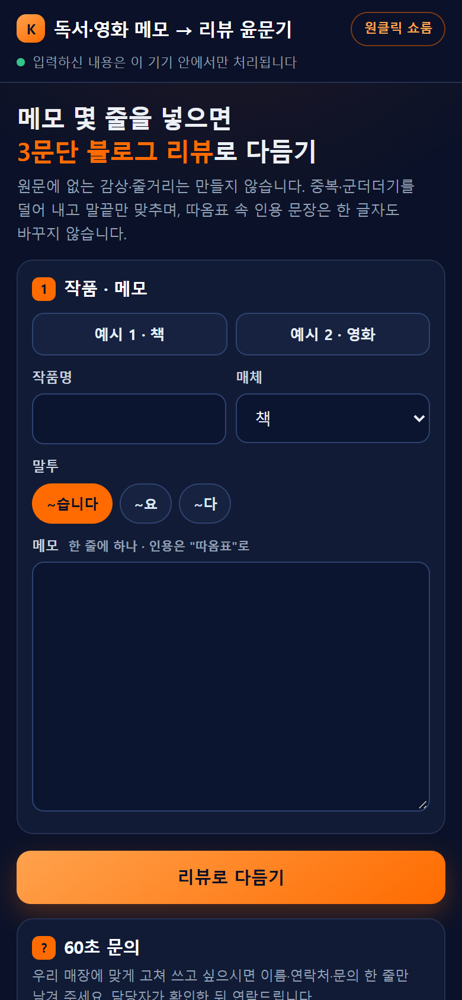
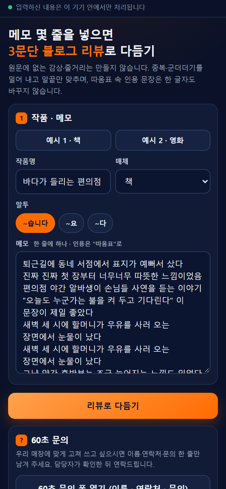
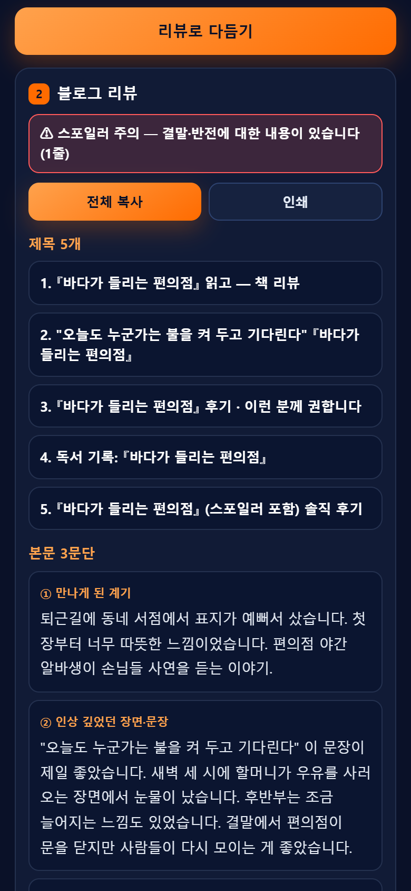

# 독서·영화 메모 → 블로그 리뷰 윤문기 사용설명서

- 앱: `oneclick/reviewpolish.html` (단일 HTML · 설치 없음 · 서버 0)
- 읽고 본 뒤 적은 메모를 ① 만나게 된 계기 ② 인상 깊었던 장면·문장 ③ 권하고 싶은 사람 3문단으로 나누고, 중복·군더더기를 덜고 말끝을 맞춥니다. 원문에 없는 감상·줄거리는 만들지 않고, 따옴표 속 인용은 그대로 둡니다. 결말·반전 언급이 있으면 스포일러 경고가 자동으로 붙습니다.
- 입력하신 내용은 이 기기 안에서만 처리됩니다.

## ① 누르는 곳

[예시 1 · 책] 또는 [예시 2 · 영화]를 누르세요. 내 메모면 작품명·매체를 고르고 한 줄에 하나씩 적습니다.

## ② 입력

말투(~습니다 · ~요 · ~다)를 고르고 [리뷰로 다듬기]를 누릅니다.

## ③ 결과

제목 5개, 3문단 본문, 해시태그 15개가 나옵니다. [전체 복사]로 블로그에 붙이거나 [인쇄]하세요.

## 60초 문의
화면 맨 아래 **[60초 문의 폼 열기]** 를 누르면 KTS 60초 접수 폼(`misa-1116/form.html`)이 열립니다. 이름·연락처·문의만 남기면 됩니다.

> 390px 실물 캡처: `390_reviewpolish.png` · 실제로 누른 자리 기록: `shots/reviewpolish/marks.json` · 검증 로그: `shots/reviewpolish/run_log.txt`