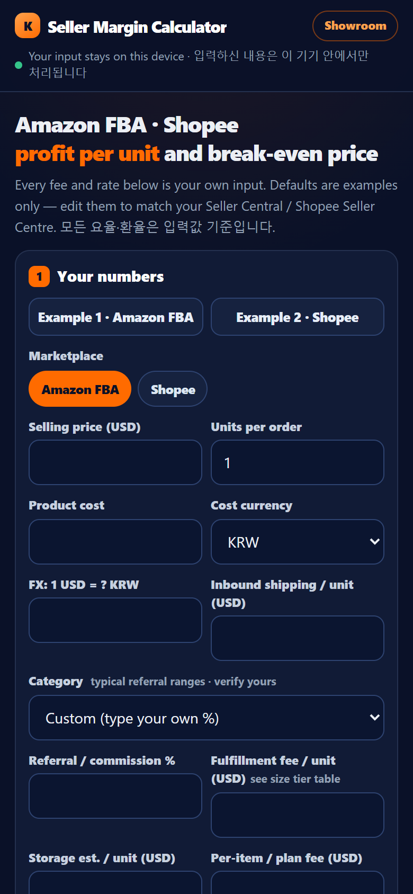
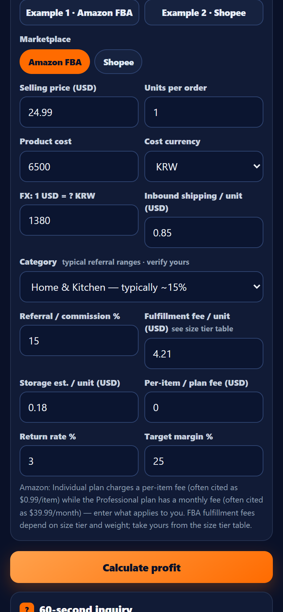
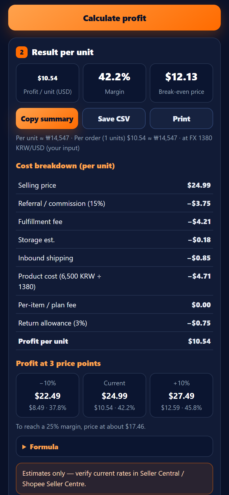

# Amazon FBA · Shopee Margin Calculator (영문 마진 계산기) 사용설명서

- 앱: `oneclick/sellercalc_en.html` (단일 HTML · 설치 없음 · 서버 0)
- 아마존 FBA·쇼피 셀러용 영문 계산기입니다. 원가·수수료율·풀필먼트비·보관비·반품률·환율을 넣으면 단위당 이익(USD·KRW), 마진율, 손익분기 가격, 가격 3개 비교, 적자 경고가 나옵니다. 요율·환율은 예시 기본값이며 화면에서 고칩니다. Estimates only — verify current rates in Seller Central / Shopee Seller Centre.
- 입력하신 내용은 이 기기 안에서만 처리됩니다.

## ① 누르는 곳

[Example 1 · Amazon FBA] 또는 [Example 2 · Shopee]를 누르세요. 내 상품은 Product cost부터 직접 넣습니다.

## ② 입력

Referral fee %·Fulfillment fee·FX를 내 Seller Central 값으로 확인하고 [Calculate profit]을 누릅니다.

## ③ 결과

이익·마진·손익분기·가격 3개 비교가 나옵니다. 이익이 0 이하이면 빨간 경고. [Copy] · [CSV].

## 60초 문의
화면 맨 아래 **[60초 문의 폼 열기]** 를 누르면 KTS 60초 접수 폼(`misa-1116/form.html`)이 열립니다. 이름·연락처·문의만 남기면 됩니다.

> 390px 실물 캡처: `390_sellercalc_en.png` · 실제로 누른 자리 기록: `shots/sellercalc_en/marks.json` · 검증 로그: `shots/sellercalc_en/run_log.txt`