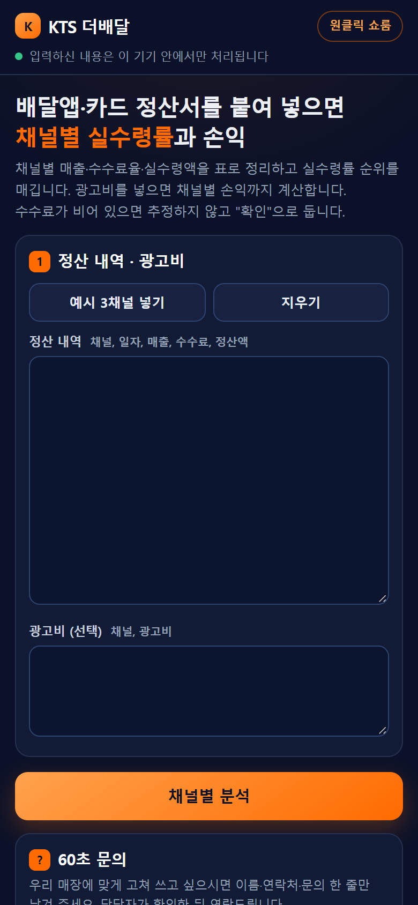
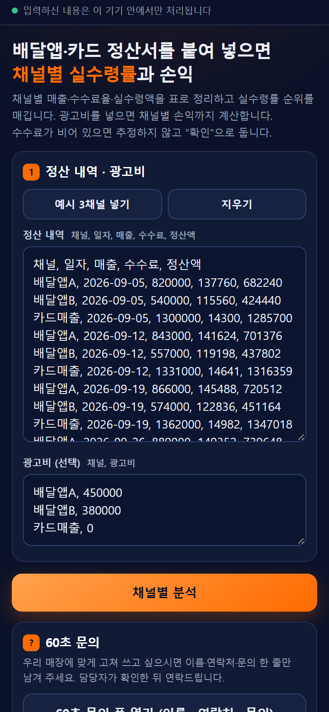
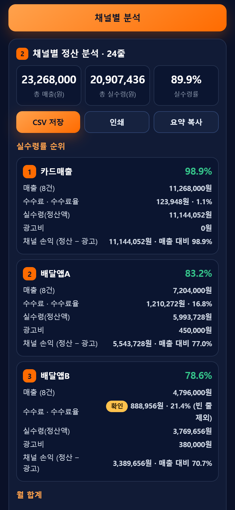

# KTS 더배달 — 채널별 매출 · 수수료 분석 사용설명서

- 앱: `oneclick/settle.html` (단일 HTML · 설치 없음 · 서버 0)
- 배달앱·카드사 정산 내역(채널·일자·매출·수수료·정산액)을 붙여 넣으면 채널별 매출·수수료율·실수령액 표와 실수령률 순위, 월 합계를 만들고, 광고비를 넣으면 채널별 손익을 계산합니다. 수수료가 비어 있으면 추정하지 않고 "확인"으로 둡니다.
- 입력하신 내용은 이 기기 안에서만 처리됩니다.

## ① 누르는 곳

[예시 3채널 넣기]를 누르거나 정산 내역을 붙여 넣으세요.

## ② 입력

광고비(선택)를 확인하고 [채널별 분석]을 누릅니다.

## ③ 결과

실수령률 순위와 채널 손익이 나옵니다. [CSV 저장] · [인쇄] · [요약 복사]로 가져가세요.

## 60초 문의
화면 맨 아래 **[60초 문의 폼 열기]** 를 누르면 KTS 60초 접수 폼(`misa-1116/form.html`)이 열립니다. 이름·연락처·문의만 남기면 됩니다.

> 390px 실물 캡처: `390_settle.png` · 실제로 누른 자리 기록: `shots/settle/marks.json` · 검증 로그: `shots/settle/run_log.txt`