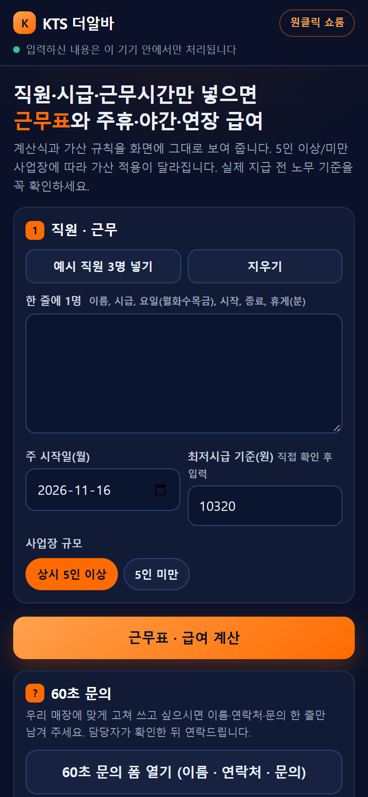
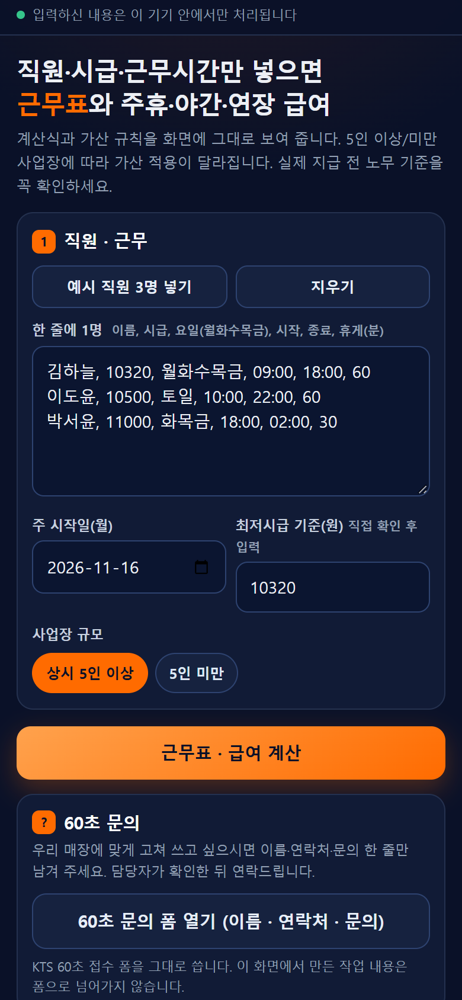
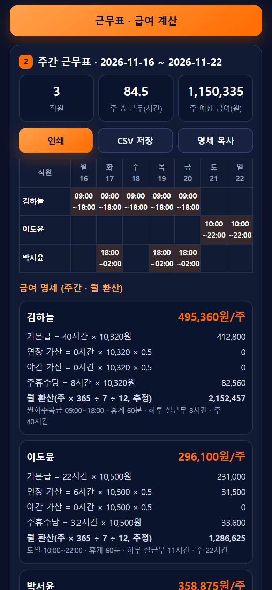

# KTS 더알바 — 근무표 + 주휴 · 야간 · 연장 계산 사용설명서

- 앱: `oneclick/shiftpay.html` (단일 HTML · 설치 없음 · 서버 0)
- 직원(이름·시급·근무 요일·시작/종료·휴게)과 주 시작일을 넣으면 주간 근무표 격자와 이번 달 근무 달력, 직원별 기본급·연장(1.5배)·야간(22~06시 0.5배 가산)·주휴수당·월 환산 급여를 계산식과 함께 보여 줍니다. 5인 미만 사업장은 가산을 빼고 계산합니다.
- 입력하신 내용은 이 기기 안에서만 처리됩니다.

## ① 누르는 곳

[예시 직원 3명 넣기]를 누르거나 "김하늘, 10320, 월화수목금, 09:00, 18:00, 60"처럼 적으세요.

## ② 입력

주 시작일·최저시급 기준(직접 확인한 값)·사업장 규모를 고르고 [근무표 · 급여 계산]을 누릅니다.

## ③ 결과

근무표와 급여 명세가 나옵니다. 계산식은 아래 "계산식 · 가산 규칙"에 공개됩니다. [인쇄] · [CSV 저장] · [명세 복사].

## 60초 문의
화면 맨 아래 **[60초 문의 폼 열기]** 를 누르면 KTS 60초 접수 폼(`misa-1116/form.html`)이 열립니다. 이름·연락처·문의만 남기면 됩니다.

> 390px 실물 캡처: `390_shiftpay.png` · 실제로 누른 자리 기록: `shots/shiftpay/marks.json` · 검증 로그: `shots/shiftpay/run_log.txt`