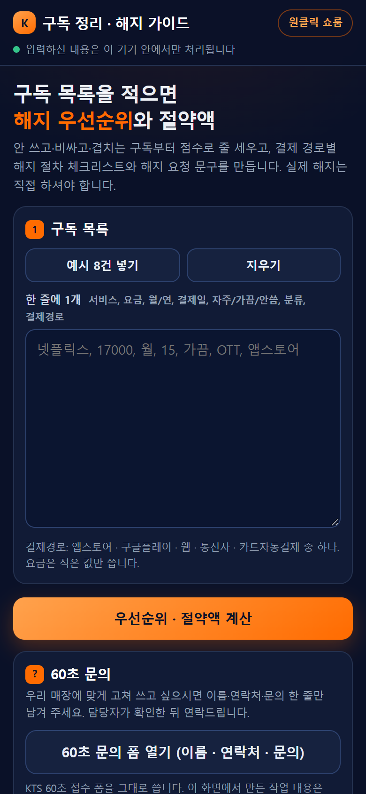
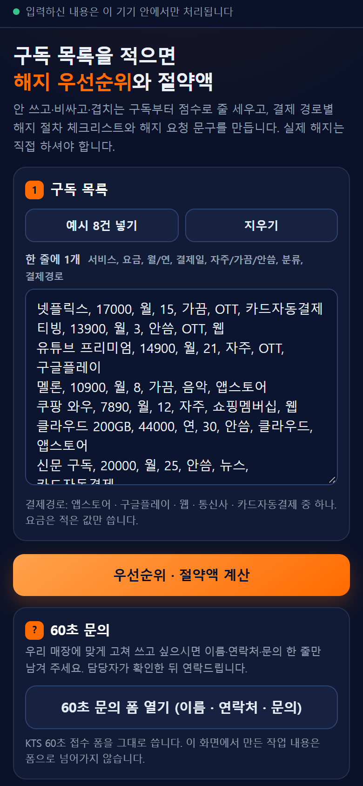
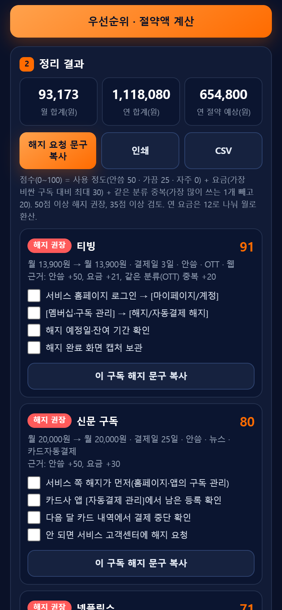

# 구독·광고 정리 · 해지 가이드 사용설명서

- 앱: `oneclick/subscribeclean.html` (단일 HTML · 설치 없음 · 서버 0)
- 구독 목록(서비스·요금·월/연·결제일·사용 정도·분류·결제 경로)을 적으면 월·연 합계, 해지 우선순위 점수(안 씀·비쌈·중복), 결제 경로별 해지 절차 체크리스트, 연 절약 예상액, 해지 요청 문구가 나옵니다. 실제 해지는 직접 합니다.
- 입력하신 내용은 이 기기 안에서만 처리됩니다.

## ① 누르는 곳

[예시 8건 넣기]를 누르거나 "넷플릭스, 17000, 월, 15, 가끔, OTT, 앱스토어"처럼 한 줄에 하나씩 적으세요.

## ② 입력

목록을 확인하고 [우선순위 · 절약액 계산]을 누릅니다.

## ③ 결과

점수 순 목록과 해지 절차 체크리스트가 나옵니다. [해지 요청 문구 복사]로 고객센터에 보내고, [인쇄]로 한 장에 정리하세요.

## 60초 문의
화면 맨 아래 **[60초 문의 폼 열기]** 를 누르면 KTS 60초 접수 폼(`misa-1116/form.html`)이 열립니다. 이름·연락처·문의만 남기면 됩니다.

> 390px 실물 캡처: `390_subscribeclean.png` · 실제로 누른 자리 기록: `shots/subscribeclean/marks.json` · 검증 로그: `shots/subscribeclean/run_log.txt`