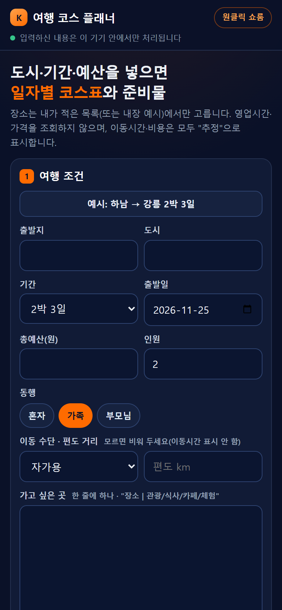
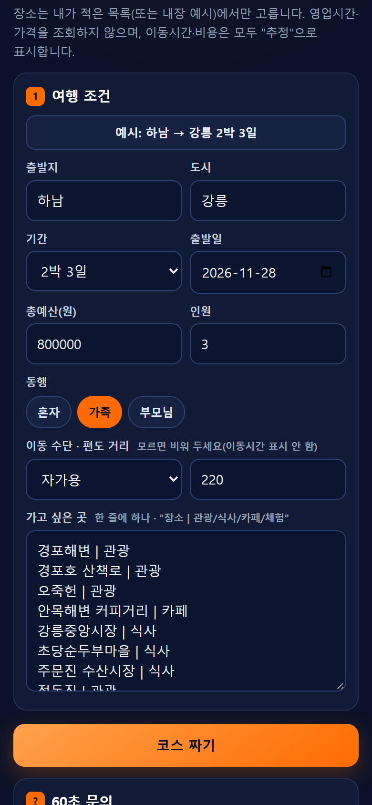
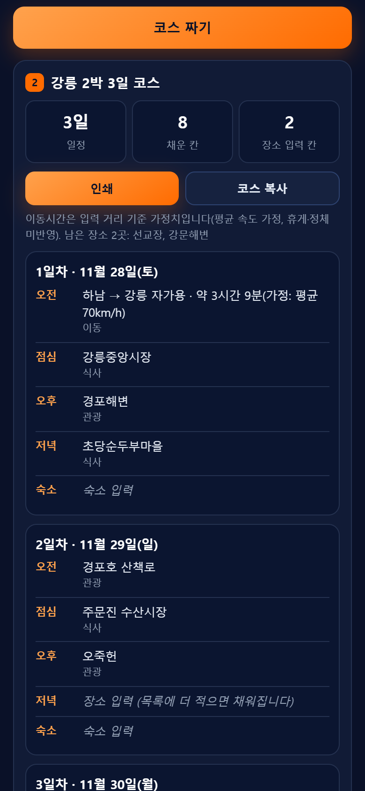

# 도시·기간·예산 → 여행 코스 플래너 사용설명서

- 앱: `oneclick/tripcourse.html` (단일 HTML · 설치 없음 · 서버 0)
- 도시·기간·예산·동행·가고 싶은 곳을 넣으면 일자별 오전/점심/오후/저녁 코스표, 예산 배분(추정), 준비물 체크리스트가 나옵니다. 장소는 내가 적은 목록에서만 고르고, 모자라면 "장소 입력" 빈칸으로 남깁니다. 영업시간·가격은 조회하지 않습니다.
- 입력하신 내용은 이 기기 안에서만 처리됩니다.

## ① 누르는 곳

[예시: 하남 → 강릉 2박 3일]을 누르세요. 내 여행이면 출발지·도시·기간을 고릅니다.

## ② 입력

예산·인원·동행·이동 수단·거리와 가고 싶은 곳("경포해변 | 관광")을 확인하고 [코스 짜기]를 누릅니다.

## ③ 결과

일자별 코스표·예산·준비물이 나옵니다. [인쇄] 또는 [코스 복사]로 가족과 나누세요. 준비물 체크는 이 기기에 저장됩니다.

## 60초 문의
화면 맨 아래 **[60초 문의 폼 열기]** 를 누르면 KTS 60초 접수 폼(`misa-1116/form.html`)이 열립니다. 이름·연락처·문의만 남기면 됩니다.

> 390px 실물 캡처: `390_tripcourse.png` · 실제로 누른 자리 기록: `shots/tripcourse/marks.json` · 검증 로그: `shots/tripcourse/run_log.txt`