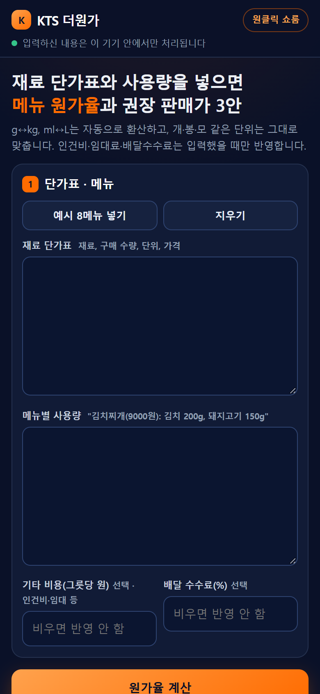
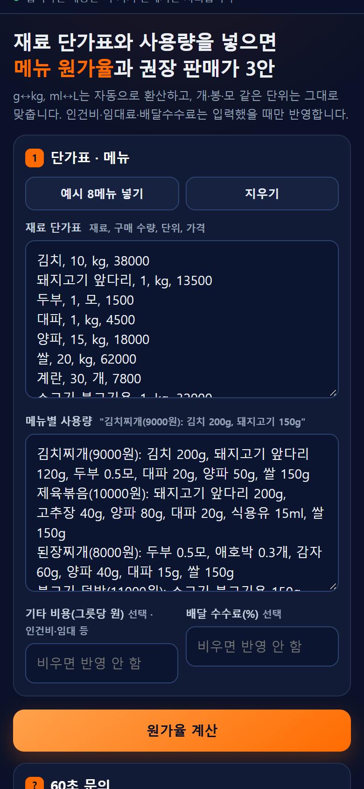
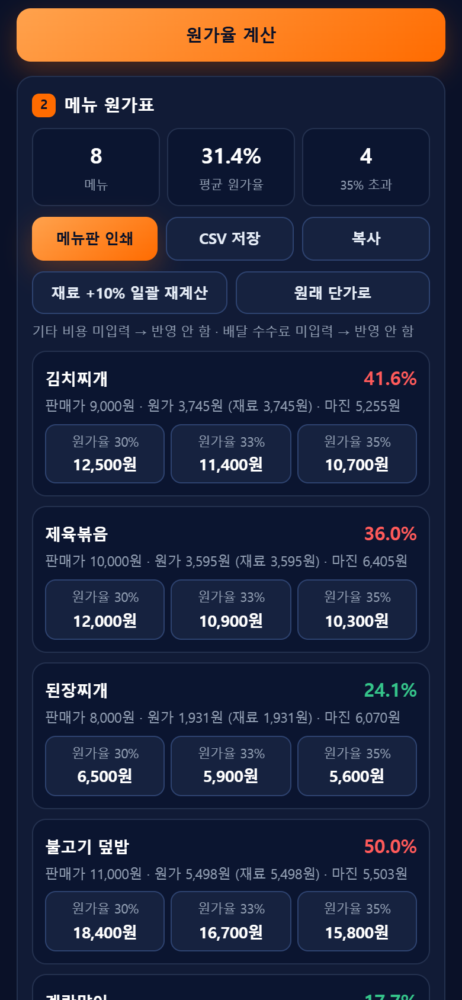

# KTS 더원가 — 메뉴 원가율 · 권장 판매가 사용설명서

- 앱: `oneclick/wonka.html` (단일 HTML · 설치 없음 · 서버 0)
- 재료 단가표(재료·구매 수량·단위·가격)와 메뉴별 사용량을 넣으면 메뉴별 원가·원가율·마진과 목표 원가율 30/33/35% 권장 판매가 3안을 계산합니다. [재료 +10%]로 단가 인상을 일괄 시뮬레이션하고, g↔kg·ml↔L만 자동 환산합니다(개·모·봉은 그대로).
- 입력하신 내용은 이 기기 안에서만 처리됩니다.

## ① 누르는 곳

[예시 8메뉴 넣기]를 누르거나 단가표와 "김치찌개(9000원): 김치 200g, …"을 적으세요.

## ② 입력

기타 비용·배달 수수료(선택, 비우면 반영 안 함)를 확인하고 [원가율 계산]을 누릅니다.

## ③ 결과

메뉴별 원가율과 권장가 3안이 나옵니다. [재료 +10% 일괄 재계산]으로 인상 영향을 보고, [메뉴판 인쇄] · [CSV 저장].

## 60초 문의
화면 맨 아래 **[60초 문의 폼 열기]** 를 누르면 KTS 60초 접수 폼(`misa-1116/form.html`)이 열립니다. 이름·연락처·문의만 남기면 됩니다.

> 390px 실물 캡처: `390_wonka.png` · 실제로 누른 자리 기록: `shots/wonka/marks.json` · 검증 로그: `shots/wonka/run_log.txt`