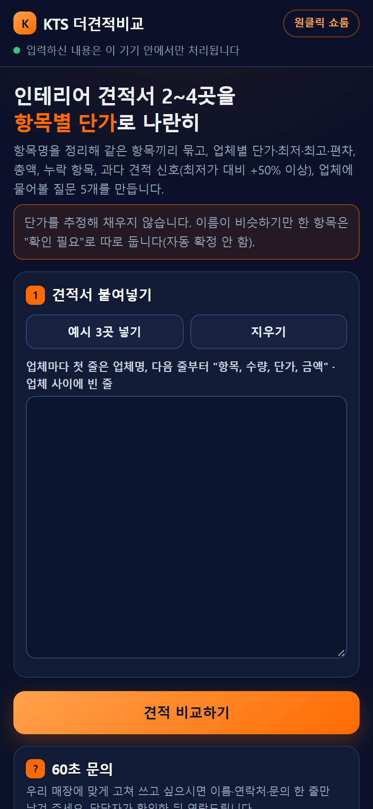
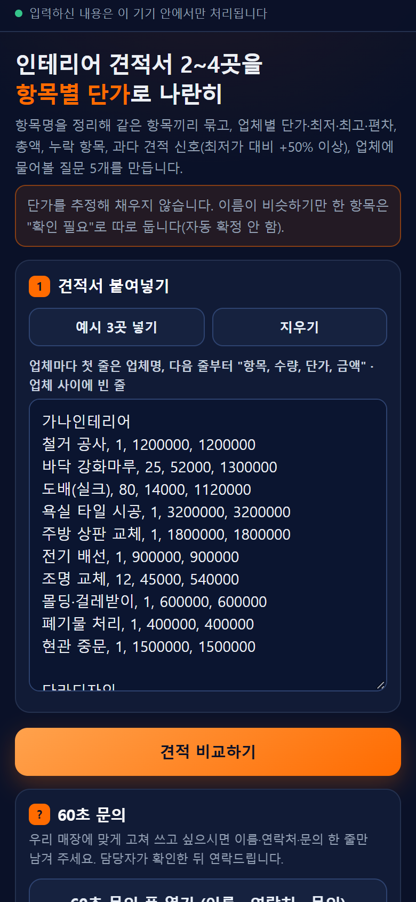
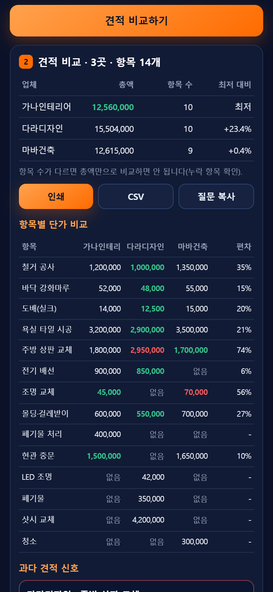

# KTS 더견적비교 — 인테리어 견적서 3곳 비교 사용설명서

- 앱: `oneclick/bidcompare.html` (단일 HTML · 설치 없음 · 서버 0)
- 견적서 2~4곳(항목·수량·단가·금액)을 붙여 넣으면 항목명을 정리해 같은 공사끼리 묶고, 업체별 단가·편차, 총액, 누락 항목, 과다 견적 신호(최저가 대비 +50% 이상), 업체에 물어볼 질문 5개를 만듭니다. 단가를 추정해 채우지 않습니다.
- 입력하신 내용은 이 기기 안에서만 처리됩니다.

## ① 누르는 곳

[예시 3곳 넣기]를 누르거나, 업체명 한 줄 + "항목, 수량, 단가, 금액" 줄을 업체마다 빈 줄로 나눠 붙여 넣으세요.

## ② 입력

[견적 비교하기]를 누릅니다.

## ③ 결과

총액·항목별 단가표(초록 최저·빨강 과다)·누락·확인 필요·질문 5개가 나옵니다. [인쇄] · [CSV] · [질문 복사].

## 60초 문의
화면 맨 아래 **[60초 문의 폼 열기]** 를 누르면 KTS 60초 접수 폼(`misa-1116/form.html`)이 열립니다. 이름·연락처·문의만 남기면 됩니다.

> 390px 실물 캡처: `390_bidcompare.png` · 실제로 누른 자리 기록: `shots/bidcompare/marks.json` · 검증 로그: `shots/bidcompare/run_log.txt`