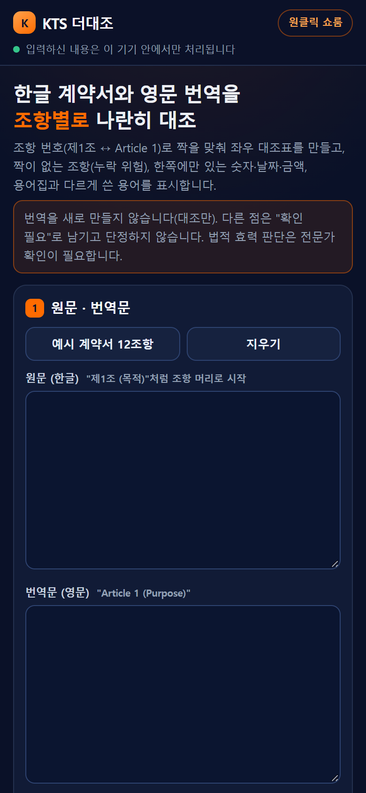
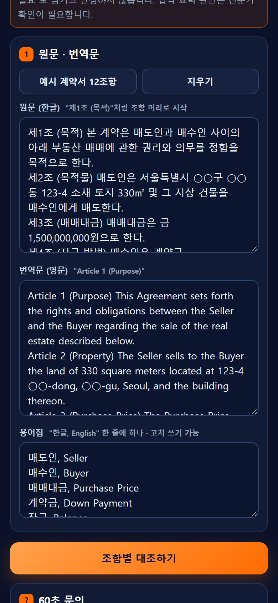
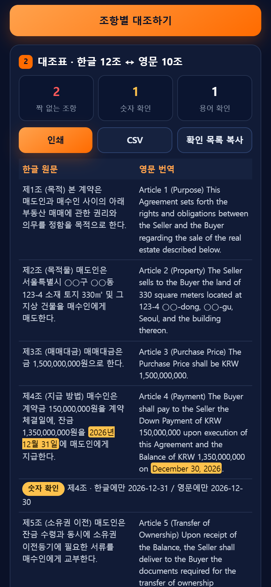

# KTS 더대조 — 한↔영 계약서 조항별 대조표 사용설명서

- 앱: `oneclick/bilingual.html` (단일 HTML · 설치 없음 · 서버 0)
- 한글 원문과 영문 번역을 붙여 넣으면 제N조 ↔ Article N으로 짝을 맞춘 좌우 대조표를 만들고, 짝 없는 조항, 한쪽에만 있는 숫자·날짜·금액, 용어집과 다른 용어를 표시합니다. 번역을 새로 만들지 않습니다.
- 입력하신 내용은 이 기기 안에서만 처리됩니다.

## ① 누르는 곳

[예시 계약서 12조항]을 누르거나 원문·번역문을 각 칸에 붙여 넣으세요.

## ② 입력

용어집을 확인하고 [조항별 대조하기]를 누릅니다.

## ③ 결과

짝 없는 조항(빨강)·숫자 확인(노랑 표시)·용어 확인이 나옵니다. [인쇄] · [CSV] · [확인 목록 복사].

## 60초 문의
화면 맨 아래 **[60초 문의 폼 열기]** 를 누르면 KTS 60초 접수 폼(`misa-1116/form.html`)이 열립니다. 이름·연락처·문의만 남기면 됩니다.

> 390px 실물 캡처: `390_bilingual.png` · 실제로 누른 자리 기록: `shots/bilingual/marks.json` · 검증 로그: `shots/bilingual/run_log.txt`