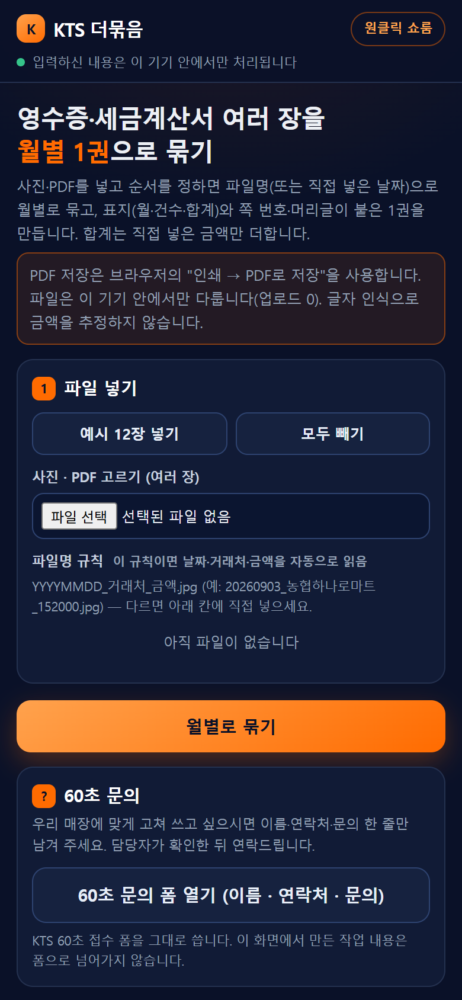
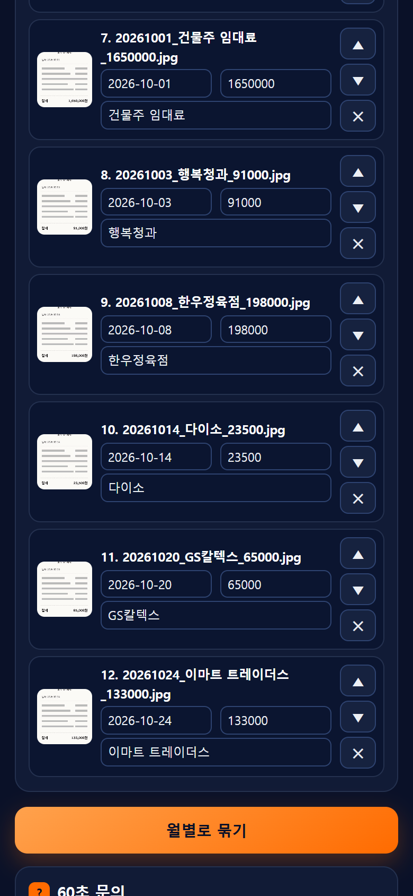
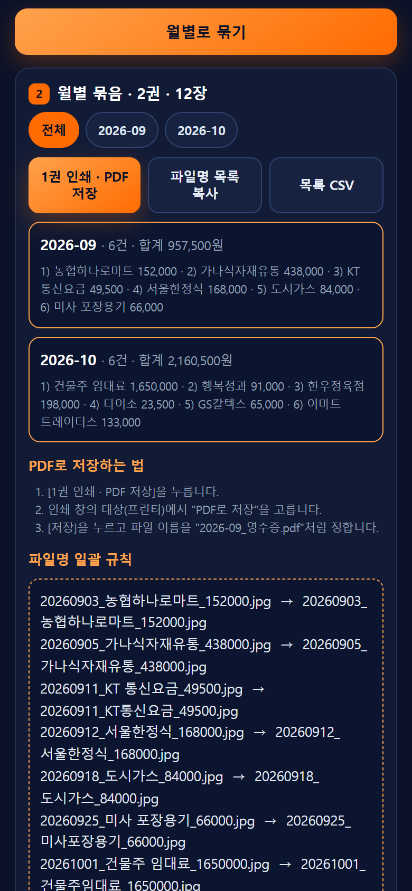

# KTS 더묶음 — 영수증·세금계산서 → 월별 1권 PDF 사용설명서

- 앱: `oneclick/bundle100.html` (단일 HTML · 설치 없음 · 서버 0)
- 영수증·세금계산서 사진(또는 PDF)을 넣고 순서를 정하면 파일명이나 직접 넣은 날짜로 월별로 묶고, 표지(월·건수·합계)와 머리글·쪽 번호가 있는 1권을 만듭니다. PDF 저장은 브라우저의 "인쇄 → PDF로 저장"을 씁니다. 합계는 직접 넣은 금액만 더합니다.
- 입력하신 내용은 이 기기 안에서만 처리됩니다.

## ① 누르는 곳

[예시 12장 넣기]를 누르거나 [파일 선택]으로 사진을 고르세요. ▲ ▼로 순서, ✕로 빼기.

## ② 입력

날짜·금액 칸을 확인하고 [월별로 묶기]를 누릅니다.

## ③ 결과

월별 묶음과 표지 합계가 나옵니다. [1권 인쇄 · PDF 저장] → 대상 "PDF로 저장". 파일명 규칙 목록은 [파일명 목록 복사].

## 60초 문의
화면 맨 아래 **[60초 문의 폼 열기]** 를 누르면 KTS 60초 접수 폼(`misa-1116/form.html`)이 열립니다. 이름·연락처·문의만 남기면 됩니다.

> 390px 실물 캡처: `390_bundle100.png` · 실제로 누른 자리 기록: `shots/bundle100/marks.json` · 검증 로그: `shots/bundle100/run_log.txt`