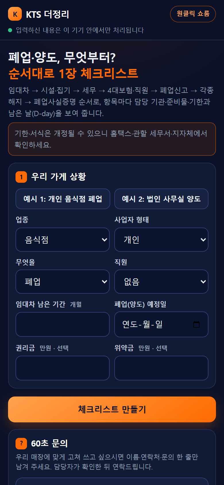
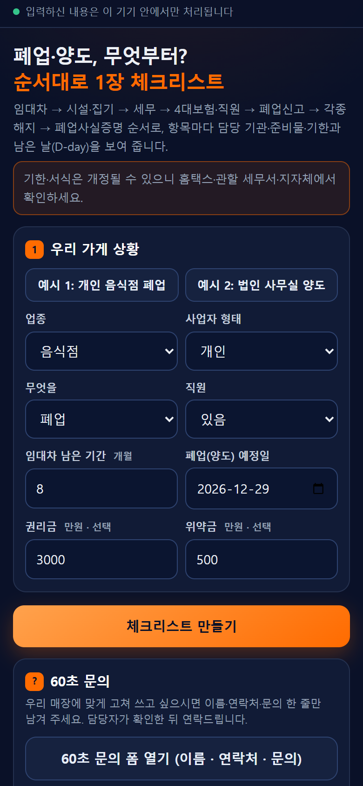
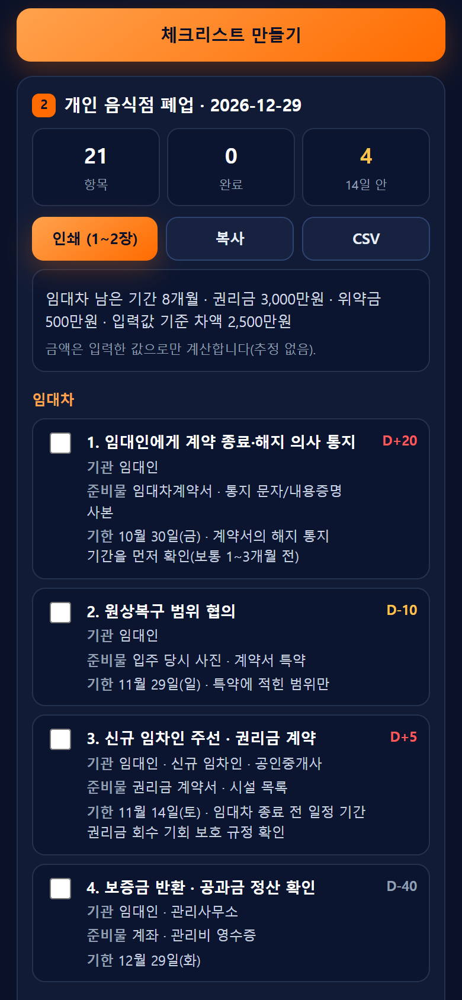

# KTS 더정리 — 폐업·양도 체크리스트 사용설명서

- 앱: `oneclick/closeshop.html` (단일 HTML · 설치 없음 · 서버 0)
- 업종·사업자 형태·직원 유무·임대차 남은 기간·폐업/양도·예정일을 넣으면 순서대로 체크리스트(20여 항목)와 항목별 담당 기관·준비물·기한·D-day를 만듭니다. 기한은 일반 절차이며 개정될 수 있습니다.
- 입력하신 내용은 이 기기 안에서만 처리됩니다.

## ① 누르는 곳

[예시 1: 개인 음식점 폐업] 또는 [예시 2: 법인 사무실 양도]를 누르세요.

## ② 입력

폐업(양도) 예정일을 확인하고 [체크리스트 만들기]를 누릅니다.

## ③ 결과

단계별 체크리스트가 D-day와 함께 나옵니다. 끝낸 항목을 체크하면 저장됩니다. [인쇄] · [복사] · [CSV].

## 60초 문의
화면 맨 아래 **[60초 문의 폼 열기]** 를 누르면 KTS 60초 접수 폼(`misa-1116/form.html`)이 열립니다. 이름·연락처·문의만 남기면 됩니다.

> 390px 실물 캡처: `390_closeshop.png` · 실제로 누른 자리 기록: `shots/closeshop/marks.json` · 검증 로그: `shots/closeshop/run_log.txt`