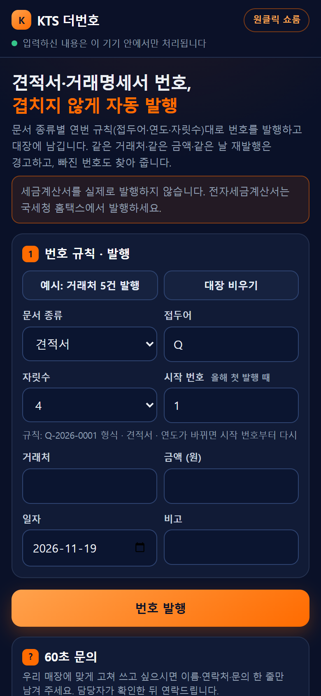
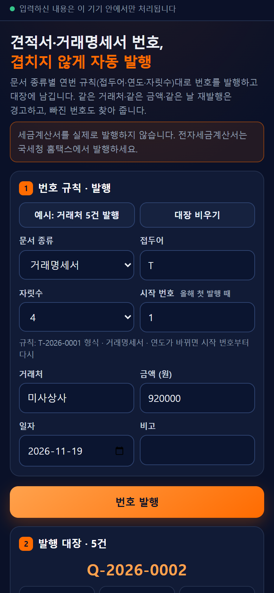
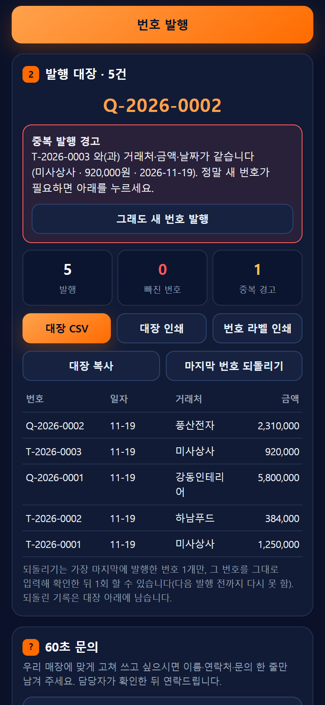

# KTS 더번호 — 견적서·거래명세서 연번 자동 발행 대장 사용설명서

- 앱: `oneclick/docnum.html` (단일 HTML · 설치 없음 · 서버 0)
- 문서 종류별 연번 규칙(접두어·연도·자릿수)대로 번호를 발행하고 대장에 남깁니다. 같은 거래처·금액·날짜 재발행은 경고하고, 빠진 번호를 찾아 주며, 마지막 번호는 번호를 다시 입력해 1회 되돌릴 수 있습니다.
- 입력하신 내용은 이 기기 안에서만 처리됩니다.

## ① 누르는 곳

[예시: 거래처 5건 발행]을 누르거나, 문서 종류·거래처·금액을 넣으세요.

## ② 입력

[번호 발행]을 누릅니다. 같은 건이면 중복 경고가 뜹니다.

## ③ 결과

발행한 번호와 대장이 나옵니다. [대장 CSV] · [대장 인쇄] · [번호 라벨 인쇄]. 세금계산서는 홈택스에서 발행하세요.

## 60초 문의
화면 맨 아래 **[60초 문의 폼 열기]** 를 누르면 KTS 60초 접수 폼(`misa-1116/form.html`)이 열립니다. 이름·연락처·문의만 남기면 됩니다.

> 390px 실물 캡처: `390_docnum.png` · 실제로 누른 자리 기록: `shots/docnum/marks.json` · 검증 로그: `shots/docnum/run_log.txt`