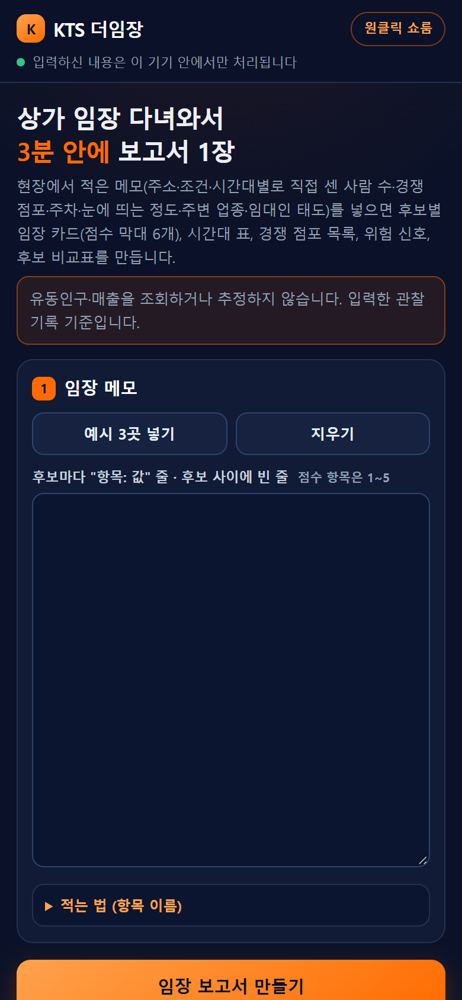
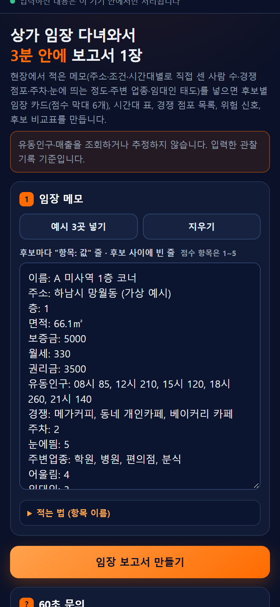
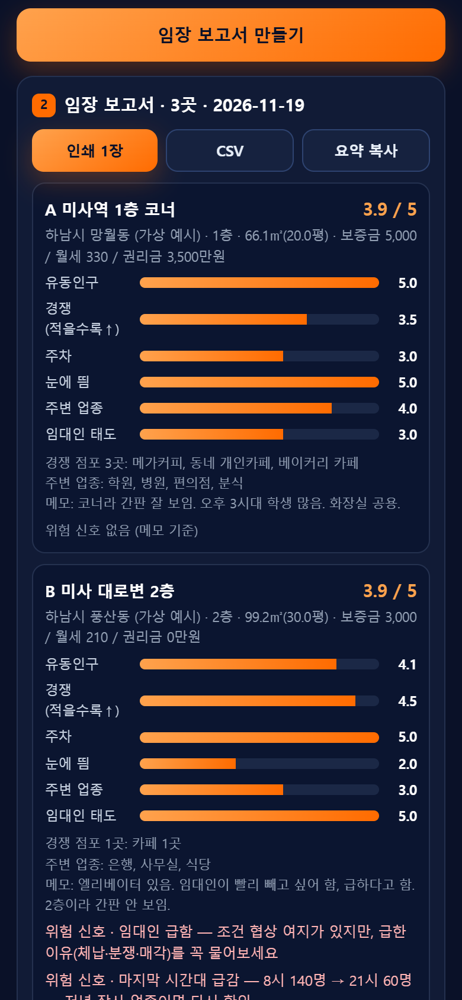

# KTS 더임장 — 상가 임장 보고서 3분 정리 사용설명서

- 앱: `oneclick/fieldreport.html` (단일 HTML · 설치 없음 · 서버 0)
- 방문한 상가의 조건과 직접 센 시간대별 유동인구·경쟁 점포·주차·눈에 띄는 정도·주변 업종·임대인 태도·메모를 넣으면 점수 막대 6항목 임장 카드, 시간대 표, 위험 신호, 후보 비교표를 만듭니다. 유동인구·매출은 조회·추정하지 않습니다.
- 입력하신 내용은 이 기기 안에서만 처리됩니다.

## ① 누르는 곳

[예시 3곳 넣기]를 누르거나, 후보마다 "항목: 값" 줄로 적고 빈 줄로 나누세요.

## ② 입력

[임장 보고서 만들기]를 누릅니다.

## ③ 결과

후보별 카드·시간대 표·비교표가 나옵니다. [인쇄 1장] · [CSV] · [요약 복사].

## 60초 문의
화면 맨 아래 **[60초 문의 폼 열기]** 를 누르면 KTS 60초 접수 폼(`misa-1116/form.html`)이 열립니다. 이름·연락처·문의만 남기면 됩니다.

> 390px 실물 캡처: `390_fieldreport.png` · 실제로 누른 자리 기록: `shots/fieldreport/marks.json` · 검증 로그: `shots/fieldreport/run_log.txt`