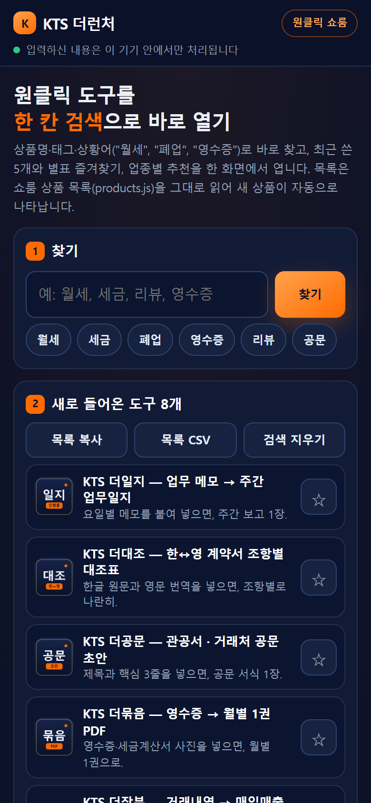
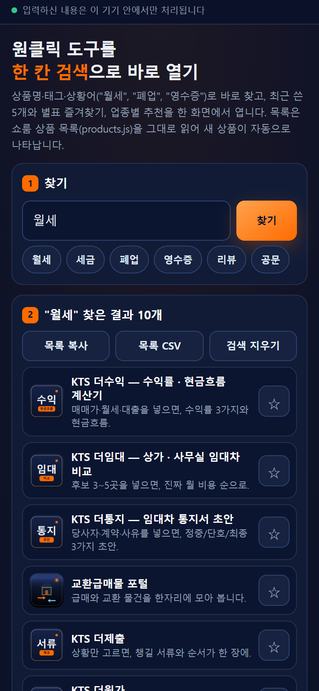
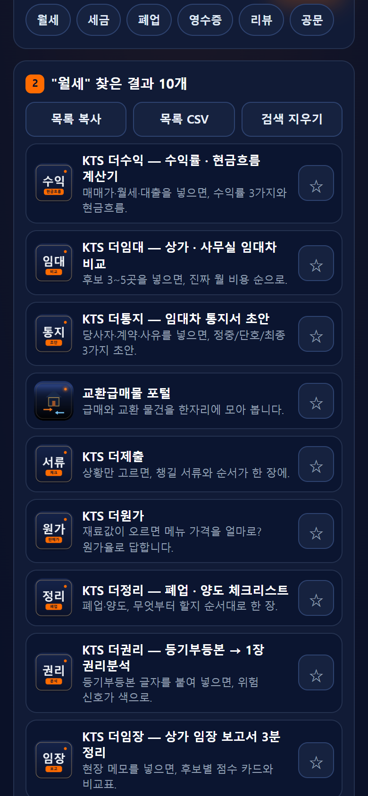

# KTS 더런처 — 원클릭 100선 통합 런처 사용설명서

- 앱: `oneclick/launcher.html` (단일 HTML · 설치 없음 · 서버 0)
- 쇼룸 상품 목록(products.js)을 그대로 읽어 한 칸 검색(상품명·태그·상황어), 최근 사용 5개, 별표 즐겨찾기, 업종별 추천(부동산·매장·사무·마케팅·생활), 분류 탭 전체 목록을 보여 줍니다. 새 상품은 자동으로 나타나고, 준비 중 상품은 열리지 않습니다.
- 입력하신 내용은 이 기기 안에서만 처리됩니다.

## ① 누르는 곳

상황어 버튼(예: [월세])을 누르거나 검색 칸에 적으세요.

## ② 입력

[찾기]를 누르면 관련도 순으로 나옵니다.

## ③ 결과

카드를 누르면 그 도구가 열리고 최근 사용에 남습니다. ☆을 누르면 즐겨찾기. [목록 복사] · [목록 CSV].

## 60초 문의
화면 맨 아래 **[60초 문의 폼 열기]** 를 누르면 KTS 60초 접수 폼(`misa-1116/form.html`)이 열립니다. 이름·연락처·문의만 남기면 됩니다.

> 390px 실물 캡처: `390_launcher.png` · 실제로 누른 자리 기록: `shots/launcher/marks.json` · 검증 로그: `shots/launcher/run_log.txt`