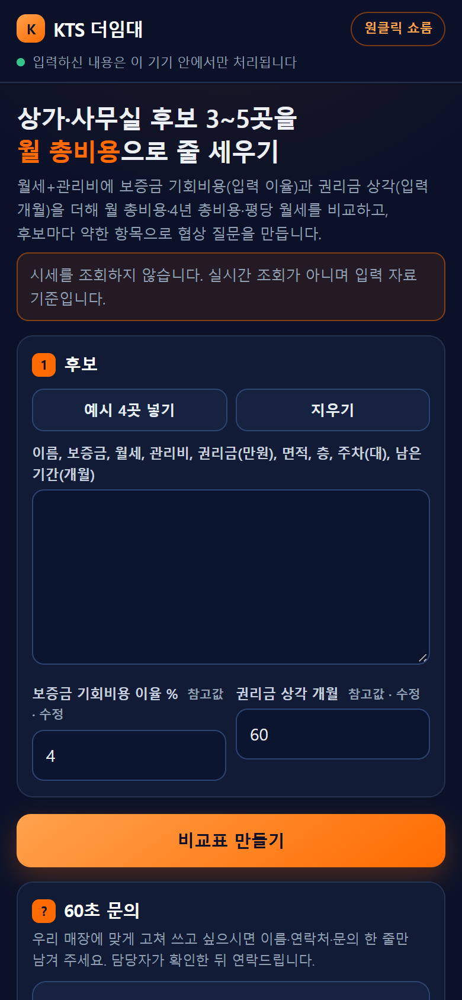
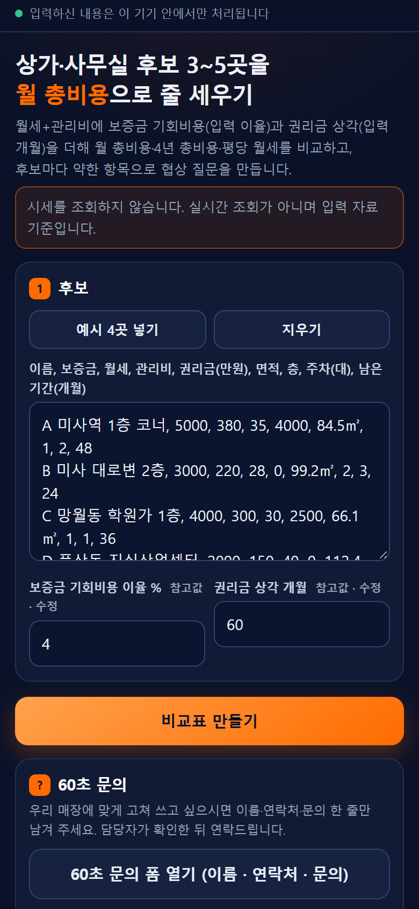
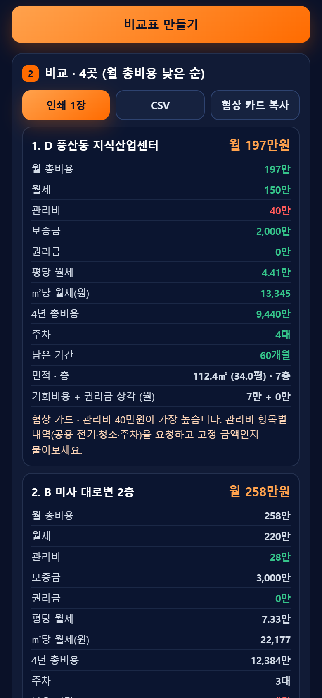

# KTS 더임대 — 상가·사무실 임대차 조건 비교표 사용설명서

- 앱: `oneclick/leaseccompare.html` (단일 HTML · 설치 없음 · 서버 0)
- 후보 3~5곳(보증금·월세·관리비·권리금·면적·층·주차·남은 기간)을 넣으면 월 총비용(기회비용·권리금 상각 포함)·4년 총비용·평당 월세를 비교하고, 후보마다 약한 항목으로 협상 질문을 만듭니다.
- 입력하신 내용은 이 기기 안에서만 처리됩니다.

## ① 누르는 곳

[예시 4곳 넣기]를 누르거나 후보를 한 줄에 한 곳씩 적으세요.

## ② 입력

기회비용 이율·권리금 상각 개월(참고값)을 확인하고 [비교표 만들기]를 누릅니다.

## ③ 결과

월 총비용 낮은 순 카드와 초록(최고)·빨강(최저) 표시, 협상 카드가 나옵니다. [인쇄 1장] · [CSV] · [협상 카드 복사].

## 60초 문의
화면 맨 아래 **[60초 문의 폼 열기]** 를 누르면 KTS 60초 접수 폼(`misa-1116/form.html`)이 열립니다. 이름·연락처·문의만 남기면 됩니다.

> 390px 실물 캡처: `390_leaseccompare.png` · 실제로 누른 자리 기록: `shots/leaseccompare/marks.json` · 검증 로그: `shots/leaseccompare/run_log.txt`