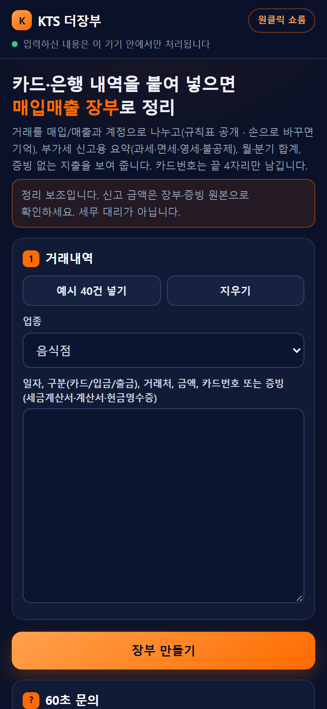
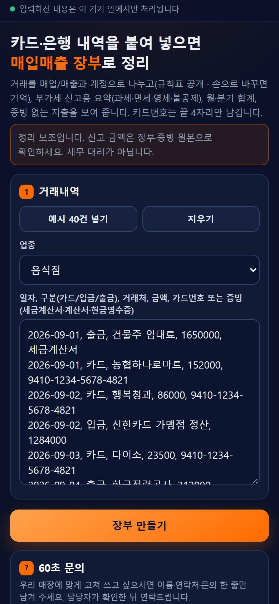
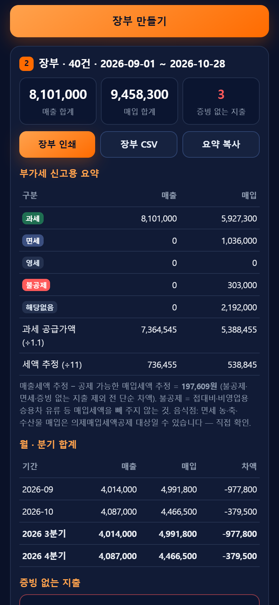

# KTS 더장부 — 카드·은행 거래내역 → 매입매출 장부 사용설명서

- 앱: `oneclick/ledger.html` (단일 HTML · 설치 없음 · 서버 0)
- 카드·은행 내역(일자·구분·거래처·금액·카드번호 또는 증빙)을 붙여 넣으면 매입/매출·계정·부가세 구분으로 나누고(규칙표 공개), 부가세 신고용 요약, 월·분기 합계, 증빙 없는 지출을 보여 줍니다. 카드번호는 끝 4자리만 남깁니다. 정리 보조이며 세무 대리가 아닙니다.
- 입력하신 내용은 이 기기 안에서만 처리됩니다.

## ① 누르는 곳

[예시 40건 넣기]를 누르거나, 거래내역을 한 줄에 한 건씩 붙여 넣으세요.

## ② 입력

업종을 고르고 [장부 만들기]를 누릅니다.

## ③ 결과

부가세 요약·월/분기 합계·증빙 없는 지출·장부가 나옵니다. 계정을 바꾸면 그 거래처는 다음부터 그 계정으로. [장부 인쇄] · [장부 CSV] · [요약 복사].

## 60초 문의
화면 맨 아래 **[60초 문의 폼 열기]** 를 누르면 KTS 60초 접수 폼(`misa-1116/form.html`)이 열립니다. 이름·연락처·문의만 남기면 됩니다.

> 390px 실물 캡처: `390_ledger.png` · 실제로 누른 자리 기록: `shots/ledger/marks.json` · 검증 로그: `shots/ledger/run_log.txt`