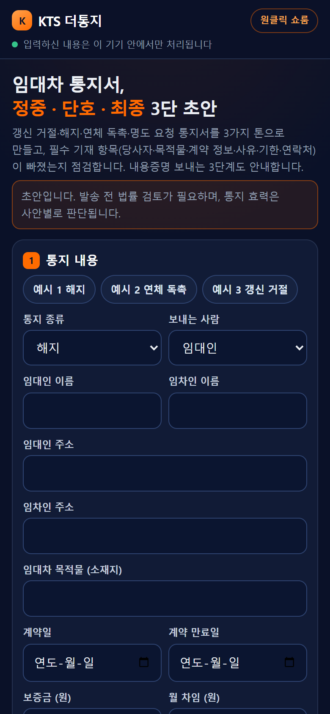
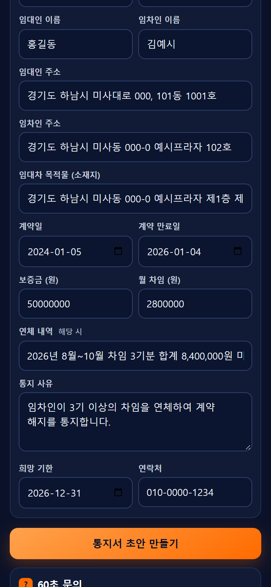
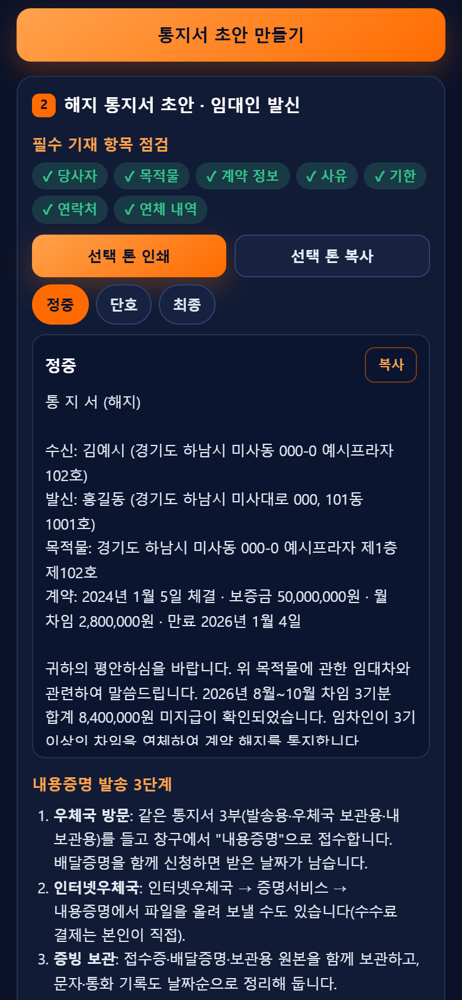

# KTS 더통지 — 임대차 갱신·해지·연체 통지서 초안 사용설명서

- 앱: `oneclick/notice.html` (단일 HTML · 설치 없음 · 서버 0)
- 통지 종류·당사자·목적물·계약 정보·사유·기한을 넣으면 정중/단호/최종 3단 톤 초안을 만들고 필수 기재 항목이 빠졌는지 점검합니다. 내용증명 발송 3단계를 안내하며 자동 발송은 하지 않습니다(복사·인쇄만).
- 입력하신 내용은 이 기기 안에서만 처리됩니다.

## ① 누르는 곳

[예시 1: 해지](또는 연체·갱신 거절 예시)를 누르세요.

## ② 입력

당사자·계약·사유·기한을 확인하고 [통지서 초안 만들기]를 누릅니다.

## ③ 결과

필수 항목 점검과 톤별 초안이 나옵니다. 톤을 골라 [인쇄] · [복사]. 발송 전 법률 검토가 필요합니다.

## 60초 문의
화면 맨 아래 **[60초 문의 폼 열기]** 를 누르면 KTS 60초 접수 폼(`misa-1116/form.html`)이 열립니다. 이름·연락처·문의만 남기면 됩니다.

> 390px 실물 캡처: `390_notice.png` · 실제로 누른 자리 기록: `shots/notice/marks.json` · 검증 로그: `shots/notice/run_log.txt`