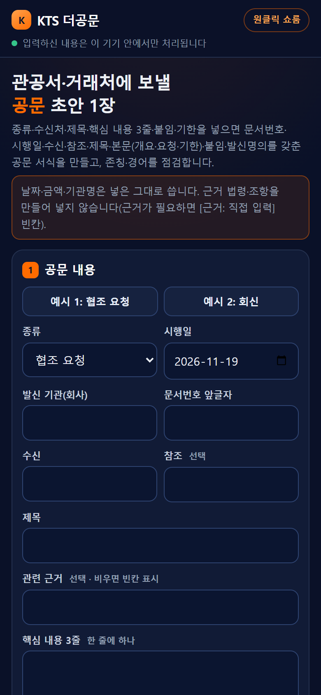
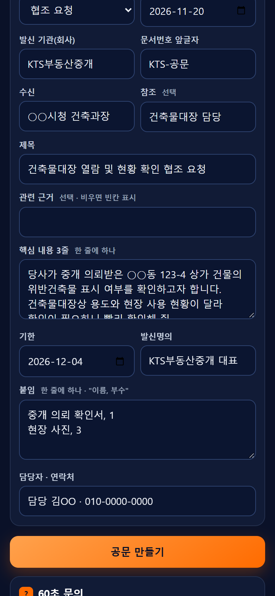
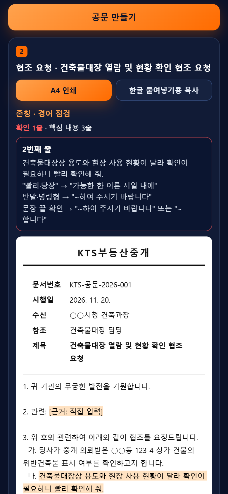

# KTS 더공문 — 관공서·거래처 공문 초안 사용설명서

- 앱: `oneclick/official.html` (단일 HTML · 설치 없음 · 서버 0)
- 종류·수신·제목·핵심 내용 3줄·붙임·기한을 넣으면 문서번호·시행일·수신·참조·제목·본문·붙임·발신명의를 갖춘 공문을 만들고 존칭·경어를 점검합니다. 근거 법령을 만들지 않고 비우면 [근거: 직접 입력]으로 남깁니다.
- 입력하신 내용은 이 기기 안에서만 처리됩니다.

## ① 누르는 곳

[예시 1: 협조 요청] 또는 [예시 2: 회신]을 누르세요.

## ② 입력

내용을 확인하고 [공문 만들기]를 누릅니다.

## ③ 결과

점검 표시(반말·강한 말·문장 끝)와 공문 미리보기가 나옵니다. 고친 뒤 [A4 인쇄] · [한글 붙여넣기용 복사].

## 60초 문의
화면 맨 아래 **[60초 문의 폼 열기]** 를 누르면 KTS 60초 접수 폼(`misa-1116/form.html`)이 열립니다. 이름·연락처·문의만 남기면 됩니다.

> 390px 실물 캡처: `390_official.png` · 실제로 누른 자리 기록: `shots/official/marks.json` · 검증 로그: `shots/official/run_log.txt`