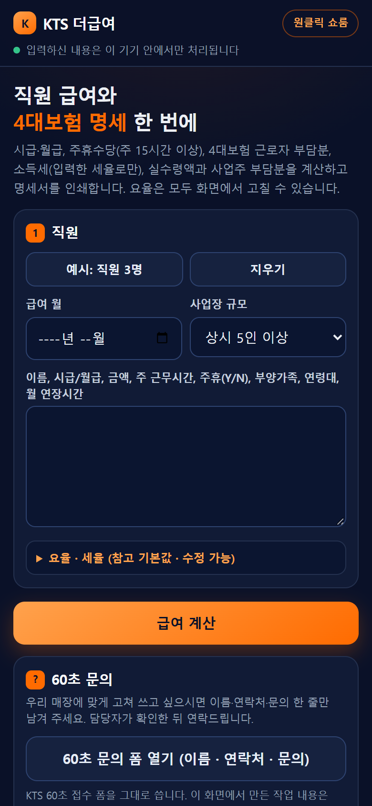
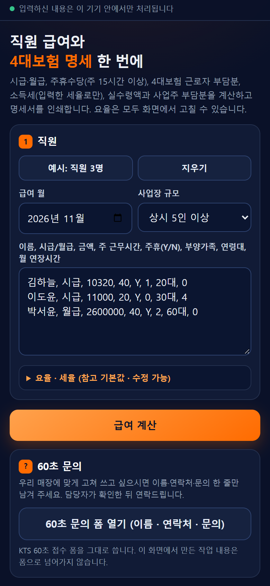
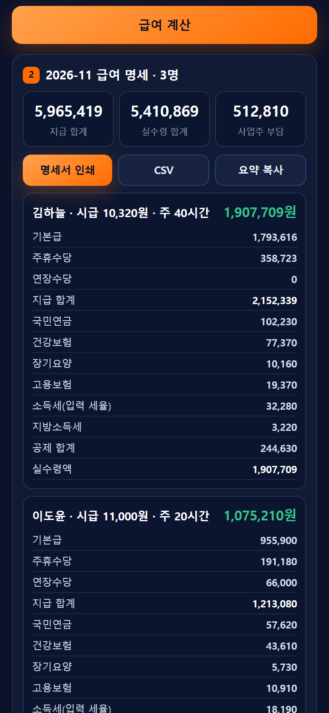

# KTS 더급여 — 직원 급여·4대보험 명세 계산·출력 사용설명서

- 앱: `oneclick/payroll.html` (단일 HTML · 설치 없음 · 서버 0)
- 직원별 시급/월급·주 근무시간·주휴·연장시간을 넣으면 주휴수당, 4대보험 근로자 부담분, 입력 세율로 계산한 소득세, 실수령액, 사업주 부담분을 계산하고 명세서를 인쇄합니다. 요율은 참고 기본값이며 수정할 수 있습니다.
- 입력하신 내용은 이 기기 안에서만 처리됩니다.

## ① 누르는 곳

[예시: 직원 3명]을 누르거나 직원을 한 줄에 한 명씩 적으세요.

## ② 입력

사업장 규모(5인 이상/미만)와 요율을 확인하고 [급여 계산]을 누릅니다.

## ③ 결과

직원별 명세와 월 합계·사업주 부담이 나옵니다. 계산식은 화면에 공개됩니다. [명세서 인쇄] · [CSV] · [요약 복사].

## 60초 문의
화면 맨 아래 **[60초 문의 폼 열기]** 를 누르면 KTS 60초 접수 폼(`misa-1116/form.html`)이 열립니다. 이름·연락처·문의만 남기면 됩니다.

> 390px 실물 캡처: `390_payroll.png` · 실제로 누른 자리 기록: `shots/payroll/marks.json` · 검증 로그: `shots/payroll/run_log.txt`