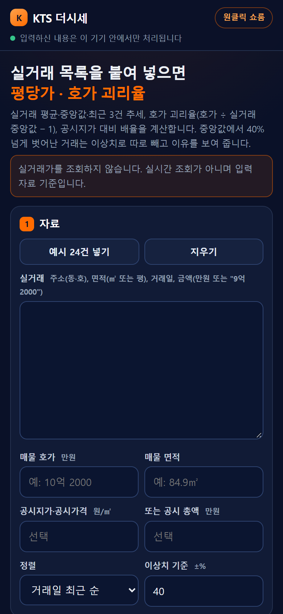
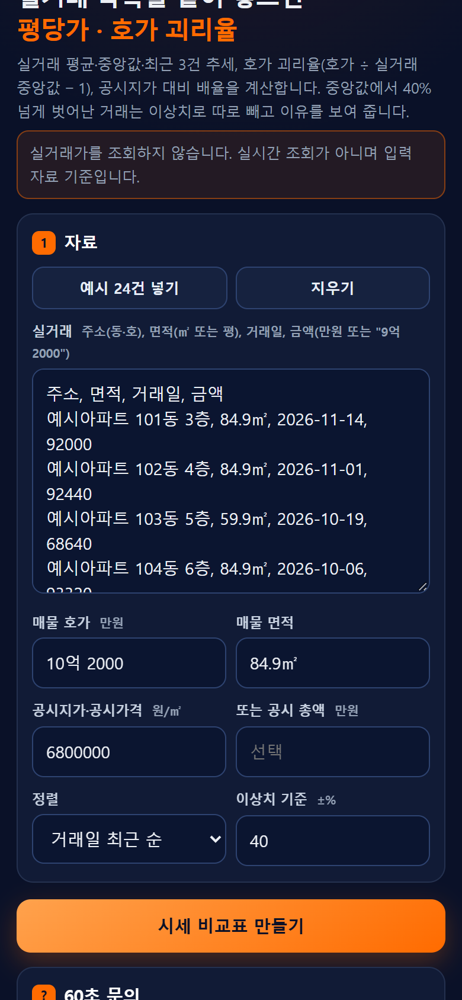
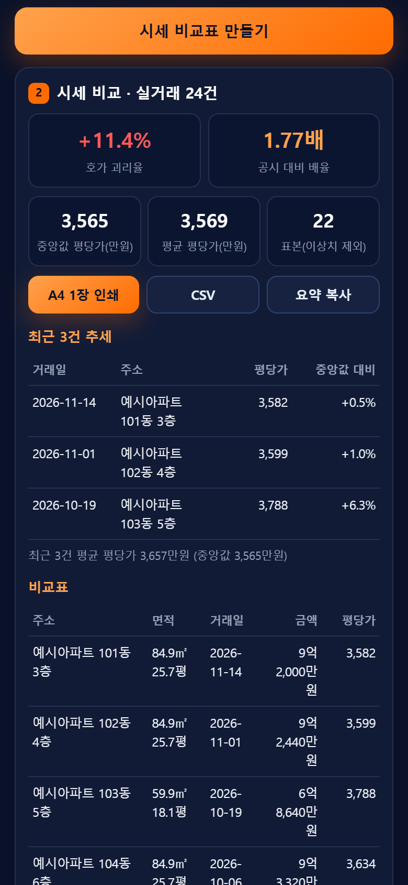

# KTS 더시세 — 실거래가·공시지가 → 시세 비교표·호가 괴리율 사용설명서

- 앱: `oneclick/pricegap.html` (단일 HTML · 설치 없음 · 서버 0)
- 실거래 목록(주소·면적·거래일·금액)과 매물 호가·공시지가를 넣으면 평당가, 평균·중앙값·최근 3건 추세, 호가 괴리율, 공시 대비 배율을 계산하고 이상치(중앙값 ±40% 밖)를 이유와 함께 뺍니다. 입력 자료 기준입니다.
- 입력하신 내용은 이 기기 안에서만 처리됩니다.

## ① 누르는 곳

[예시 24건 넣기]를 누르거나 실거래를 한 줄에 한 건씩 붙여 넣으세요.

## ② 입력

매물 호가·면적, 공시지가(선택)를 확인하고 [시세 비교표 만들기]를 누릅니다.

## ③ 결과

괴리율·배율·비교표·이상치가 나옵니다. 표본이 3건 미만이면 "참고만" 경고. [A4 1장 인쇄] · [CSV] · [요약 복사].

## 60초 문의
화면 맨 아래 **[60초 문의 폼 열기]** 를 누르면 KTS 60초 접수 폼(`misa-1116/form.html`)이 열립니다. 이름·연락처·문의만 남기면 됩니다.

> 390px 실물 캡처: `390_pricegap.png` · 실제로 누른 자리 기록: `shots/pricegap/marks.json` · 검증 로그: `shots/pricegap/run_log.txt`