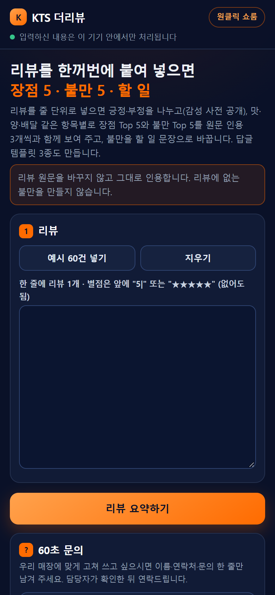
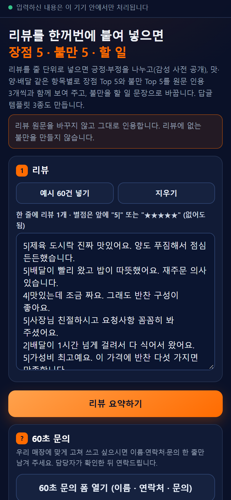
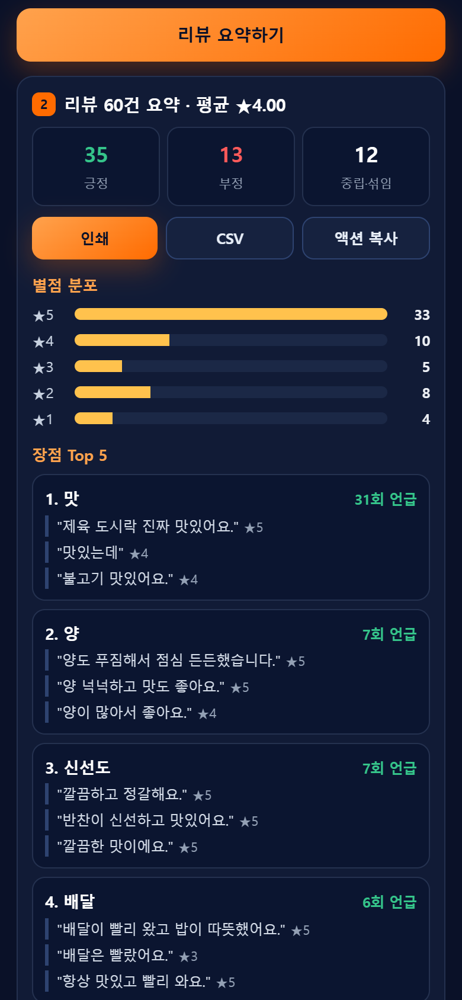

# KTS 더리뷰 — 리뷰 100개 → 장점·불만 요약 + 개선 액션 사용설명서

- 앱: `oneclick/reviewsum.html` (단일 HTML · 설치 없음 · 서버 0)
- 리뷰를 줄 단위로 넣으면(별점 "5|" 선택) 긍정·부정을 나누고 항목별 장점 Top 5·불만 Top 5를 원문 인용 3개씩 보여 주며, 불만을 할 일 문장으로 바꾸고 답글 템플릿 3종을 만듭니다. 원문을 바꾸지 않고, 리뷰에 없는 불만은 만들지 않습니다.
- 입력하신 내용은 이 기기 안에서만 처리됩니다.

## ① 누르는 곳

[예시 60건 넣기]를 누르거나 리뷰를 한 줄에 하나씩 붙여 넣으세요.

## ② 입력

[리뷰 요약하기]를 누릅니다.

## ③ 결과

별점 분포·장점/불만 Top 5·개선 액션·답글 3종이 나옵니다. [인쇄] · [CSV] · [액션 복사].

## 60초 문의
화면 맨 아래 **[60초 문의 폼 열기]** 를 누르면 KTS 60초 접수 폼(`misa-1116/form.html`)이 열립니다. 이름·연락처·문의만 남기면 됩니다.

> 390px 실물 캡처: `390_reviewsum.png` · 실제로 누른 자리 기록: `shots/reviewsum/marks.json` · 검증 로그: `shots/reviewsum/run_log.txt`