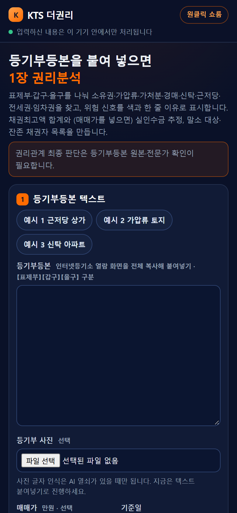
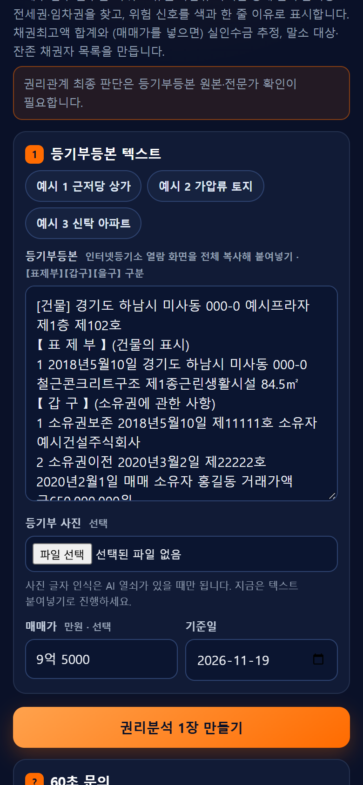
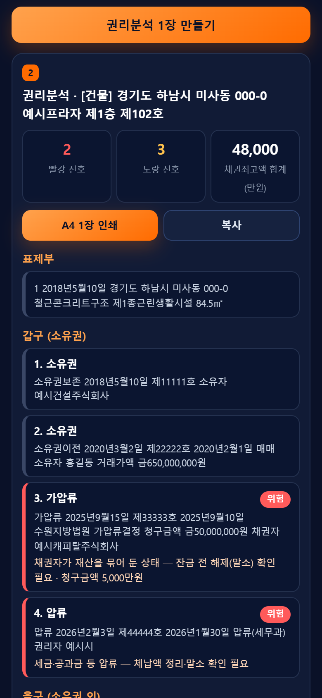

# KTS 더권리 — 등기부등본 → 1장 권리분석 사용설명서

- 앱: `oneclick/rights1p.html` (단일 HTML · 설치 없음 · 서버 0)
- 등기부등본 텍스트(표제부·갑구·을구)를 붙여 넣으면 소유권·가압류·가처분·경매·신탁·근저당·전세권·임차권을 찾아 위험 신호를 색과 한 줄 이유로 표시하고, 채권최고액 합계·실인수금 추정·말소 대상 목록을 A4 1장으로 만듭니다. 최종 판단은 원본·전문가 확인이 필요합니다.
- 입력하신 내용은 이 기기 안에서만 처리됩니다.

## ① 누르는 곳

[예시 1 근저당 상가](또는 예시 2·3)를 누르거나, 인터넷등기소 열람 화면을 전체 복사해 붙여 넣으세요.

## ② 입력

매매가(선택)를 넣고 [권리분석 1장 만들기]를 누릅니다.

## ③ 결과

갑구·을구 카드에 빨강(위험)·노랑(주의)과 이유가 나옵니다. 금액 정리·말소 대상을 확인하고 [A4 1장 인쇄] · [복사].

## 60초 문의
화면 맨 아래 **[60초 문의 폼 열기]** 를 누르면 KTS 60초 접수 폼(`misa-1116/form.html`)이 열립니다. 이름·연락처·문의만 남기면 됩니다.

> 390px 실물 캡처: `390_rights1p.png` · 실제로 누른 자리 기록: `shots/rights1p/marks.json` · 검증 로그: `shots/rights1p/run_log.txt`