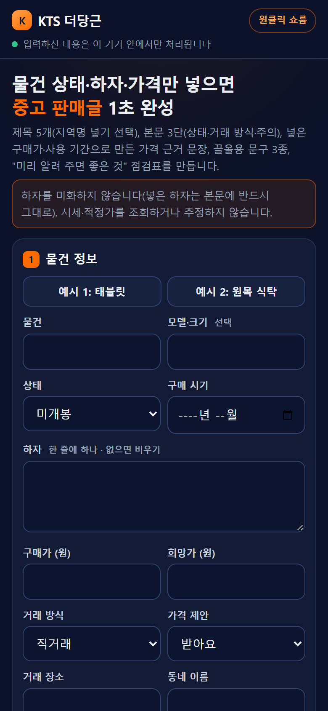
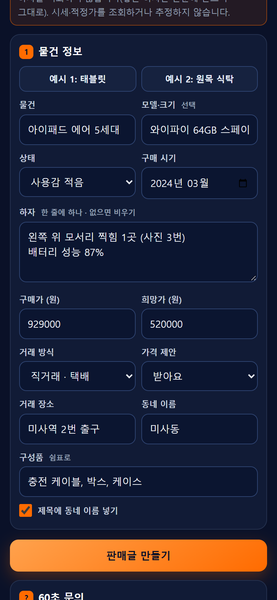
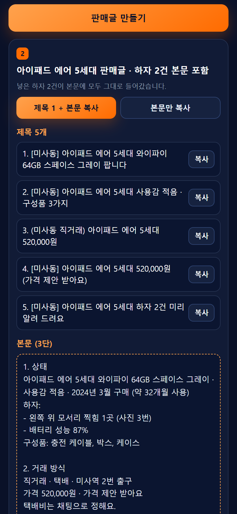

# KTS 더당근 — 중고·당근 판매글 1초 작성 사용설명서

- 앱: `oneclick/secondhand.html` (단일 HTML · 설치 없음 · 서버 0)
- 물건·상태·하자·구매 시기·구매가·희망가·거래 방식을 넣으면 제목 5개, 본문 3단(상태·거래 방식·주의), 넣은 숫자로만 만든 가격 근거, 끌올 문구 3종, 미리 알려 줄 것 점검표를 만듭니다. 넣은 하자는 본문에 반드시 들어가고, 하자를 줄여 말하면 경고합니다.
- 입력하신 내용은 이 기기 안에서만 처리됩니다.

## ① 누르는 곳

[예시 1: 태블릿] 또는 [예시 2: 원목 식탁]을 누르세요.

## ② 입력

하자 칸을 꼭 채우고 [판매글 만들기]를 누릅니다.

## ③ 결과

경고·제목 5개·본문·가격 근거·끌올 문구가 나옵니다. [제목 1 + 본문 복사] 또는 항목별 [복사].

## 60초 문의
화면 맨 아래 **[60초 문의 폼 열기]** 를 누르면 KTS 60초 접수 폼(`misa-1116/form.html`)이 열립니다. 이름·연락처·문의만 남기면 됩니다.

> 390px 실물 캡처: `390_secondhand.png` · 실제로 누른 자리 기록: `shots/secondhand/marks.json` · 검증 로그: `shots/secondhand/run_log.txt`